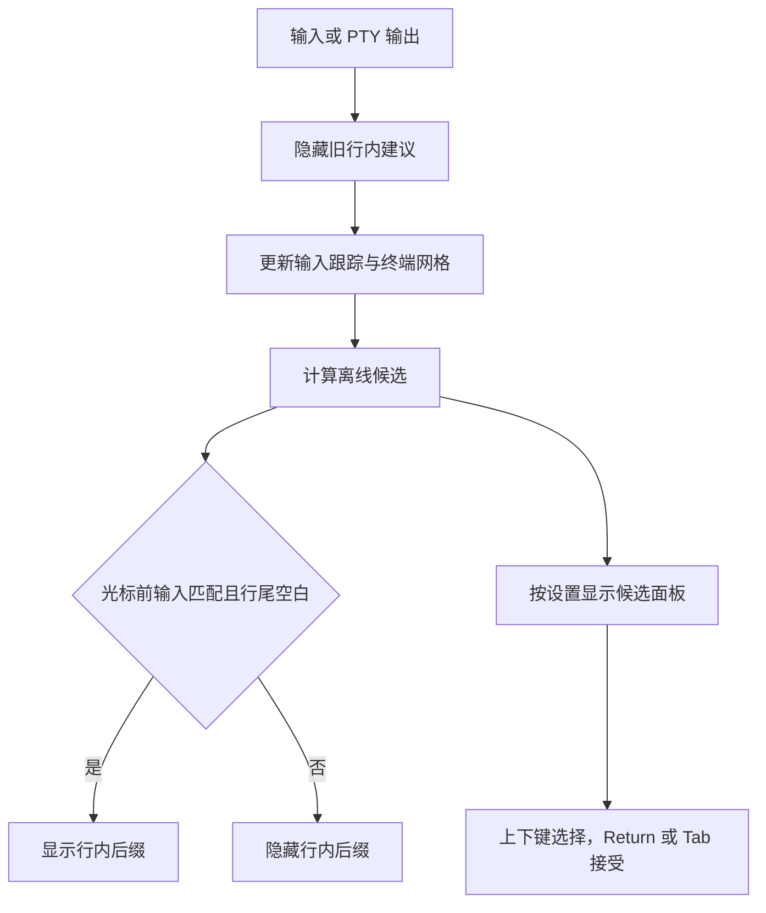

# 自动补全领域

## 背景与规则

对齐 [Otty 自动补全文档](https://docs.otty.sh/terminal-features/autocomplete) 的行内建议与候选面板，
补全来源和本机学习继续复用现有离线规格、目录历史、固定命令、README、文件与纠错服务。
空提示符仅推荐目录相关命令，不枚举所有规格；纯空格不产生候选。失败纠错可在下一条空提示符推荐。

`PromptInputTracker` 表示本地输入意图，终端网格表示已回显事实，两者不能互相替代。
只有可靠输入位于真实光标之前、光标之后没有 Shell 建议，才允许画或接受行内建议。
Ghostty 必须读取实际光标所在行；“可见区域最后一个非空行”可能是旧历史，不能作为证据。
每次 PTY 输出均撤下旧 ghost，并在终端消费分片后复查；光标移位、Shell 异步建议、重绘都会使旧结论失效。

## 流程

## 实现与边界

- `TerminalAutocompleteController` 管理候选、输入生命周期、接受与可见性；两个 terminal adapter 提供网格校验。
- Ghostty `readLine` 可限定包含端点的列范围，用于光标前缀/后缀读取。光标离开可见区或进入备用屏时拒绝行内建议。
- IME x 为单元格中点，width 为预编辑宽度；补全从左缘绘制，保持 IME 原始坐标不变。
- 自动面板初始没有明确选择；唯一候选、首项明显领先或用户选中候选后才显示 inline，预览后缀跟随选中项。Esc 关闭后本轮不自动弹回，继续输入重新筛选。
- 面板最多八行；空间不足时减少行数并跟随选中项，完全放不下一行时隐藏。面板宽度不超过 Pane。
- 候选面板、描述侧栏、选中底色与滚动条的动态颜色统一在浮层 `effectiveAppearance` 上下文中转成 `CGColor`；挂入窗口和明暗外观切换后重算，避免异步补全回调沿用 Aqua 上下文，造成暗色窗口白底浅字。
- 多物理行输入未能核对完整前缀时保守隐藏行内建议，候选仍可在面板选择；不按字符串长度猜 Unicode 网格列。

## 剪贴板建议

用户从别处复制一条命令后，空提示符上把剪贴板内容画成 ghost，**回车只写入输入行、不执行**，
再按一次回车才真正运行。开关是 `controls.clipboardSuggestion`（默认开启）。

设计取舍：

- **走候选通道而不是另起一套。** 剪贴板建议是一条普通 `AutocompleteCandidate`
  （`kind == .clipboard`、`replacement == .fullLine`），在 `refreshNow` 里注入，
  ghost 渲染、可见性校验、`acceptCandidate` 全部复用既有实现。强意图整行候选的排序是
  **纠错 > 剪贴板 > 下一步 > 项目命令**：剪贴板是用户几秒前的显式动作，只让位给
  「上一条命令刚打错」这个确定性更高的信号。
- **两段准入。** `ClipboardSuggestionPolicy`（AsterCore，纯逻辑）先判断内容结构：空行、
  单行、≤128 字符、无控制字符、无 CJK、非 URL、首词写法像命令名。结构判定区分不了
  `git status` 和 `Please review this`，所以还有第二段：`isSelfEvidentCommand` 认下写法能
  自证的内容（选项、管道、重定向、`&&`、环境变量赋值、路径形式、单个 token），其余才由
  `AutocompleteService.knowsCommand` 查规格库 / 别名 / 学习历史 / `PATH`。
  只查已知命令过于严格——`uvx ruff check`、刚装的工具、要贴到远端主机执行的命令，
  本机都不认识；而选项与管道这些写法在自然语言里几乎不会出现，看到就可以放行。
- **回车的防误触。** 空提示符上的回车原本只是换一行，是最高频的无意识按键。因此
  ghost **完整画出来**满 300 毫秒（`clipboardSuggestionArmDelay`）之后才允许被回车接受；
  等待回显期间 ghost 隐藏、Pane 太窄导致 ghost 被裁时都不计时——用户没真正看见的内容
  不能算已确认。带修饰键的 Return、长按重复、输入法组字中的回车一律原样放行。
- **变更检测不用定时器。** macOS 没有剪贴板变更通知，`ClipboardSuggestionMonitor` 只在
  应用重新激活、新提示符就绪、以及 Aster 自己写剪贴板（`noteLocalChange`）这三个时刻
  比较 `changeCount`。终端内「选中即复制」既不切换应用也不产生 OSC 133，第三个时刻
  专为它存在。
- **隐私边界。** 密码管理器的 `org.nspasteboard.ConcealedType`（以及 Transient /
  AutoGenerated）整条跳过；安全输入生效时不提示；读取前先看 `types` 再取内容，避免
  Universal Clipboard 的远端条目在渲染热路径上同步拉取。「接受或忽略」按 `changeCount`
  全局记账，一份内容在任何一个 Pane 用过或忽略过，就不会再到别处重复弹。
- **只给聚焦的 Pane。** 剪贴板是全局的，判据是 `isKeyWindow && firstResponder === view`，
  在 `TerminalSession` 绑定 `clipboardSuggestionProvider` 时判断——控制器只关心
  「有没有可提示的文本」，测试因此既不用造真窗口也不用碰真实 `NSPasteboard`。

已知限制：`tracker.line` 为空不等于屏幕输入行为空。zle 预填（`print -z`）这类不经过键盘
字节的写入会让建议画在已有文本之后；后果是回车把内容插到已有文本尾部，不会执行。

## 纠错规则

`CommandCorrectionParser.suggestions`（`CommandCorrection.swift` / `CommandCorrectionRules.swift`）在 OSC 133 D
且退出码非零时运行，返回按确定性排序、去重后的最多 3 条 `CommandCorrection`；控制器把首条作 ghost，其余
进面板。规则顺序：工具明说的更正（`most similar command` / `did you mean`）> 结构性规则 > 命令名编辑距离 >
包运行器 > `sudo`。结构性规则：

| 规则 | 触发 | 建议 |
|---|---|---|
| `pullBeforePush` | `git push` + `Updates were rejected because … (remote contains work / tip … behind / fetch first)`，无 `--force*`/`-f` | `git pull --rebase && <原命令>` |
| `switchExistingBranch` | `(fatal|error): a branch named 'X' already exists` | 原命令含 `checkout` → `git checkout X`，否则 `git switch X` |
| `nearestDirectory` | `cd`/`pushd` + zsh/bash/fish 三种「目录不存在」文案 | 在父目录里按 Levenshtein（容差 `max(1, len/3+1)`）找最近目录；含空格时单引号 |
| `terraformInit` | `terraform`/`tofu` + 未初始化文案 | `<tool> init && <原命令>` |
| `packageRunner` | 退出码 127 或 command not found，且 `node_modules/.bin/<cmd>` 存在（按锁文件选 `npx`/`pnpm exec`/`bunx`/`yarn`），或命令名在内置 npm/PyPI/gem CLI 表里（gem 需有 Gemfile） | `<runner> <原命令>`，如 `npx prettier …`、`uvx ruff …`、`uv run`/`poetry run`、`bundle exec` |
| `elevatePrivileges` | 输出含 permission denied / operation not permitted / EACCES，退出码非零 | `sudo <原命令>`；排除已 `sudo`、`cd`/`ssh`/`git` 等、含 `| < > ; &` 的命令和 publickey/password 类认证失败 |

磁盘事实通过 `CommandCorrectionContext` 的闭包注入：`directoryEntries(parent)` 只在 cwd 为本地绝对路径时列
目录（≤ 500 项），远端 Shell 得到空数组；Core 自己不碰文件系统，规则因此可以纯函数测试
（`CommandCorrectionRulesTests`）。整行前缀类建议（`sudo …`、`… init && …`）拼的是保留引号的原始命令行，
token 替换类建议（拼写、目录）用解引号 token 重建。

## 验证

`./scripts/test.sh --no-parallel --filter 'Autocomplete|autocomplete'` 覆盖领域排序、来源、隐私、面板、
分片回显及真实 Ghostty 光标行读取；`./scripts/test.sh --no-parallel --filter clipboardSuggestion`
覆盖剪贴板建议的准入规则与回车语义；`./scripts/test.sh --no-parallel` 为提交前全量验证。

## 候选质量与参数上下文

`AutocompleteArgumentContext` 是规格遍历的共享游标，描述命令路径、当前参数、待填写的选项值、
已用选项以及 `--` 终止状态。静态候选、文件枚举和历史参数学习必须使用同一个游标。
这不是新的顶层模块，仍属于 AppKit 无关的 `AsterCore`；磁盘枚举仍由 `AutocompleteService` 负责。

- 空参数位置同时提供可用子命令与选项；非重复选项在使用后去掉，带参选项优先补值。
- `--name=value` 的替换起点移至等号后，不把值当作选项名。`--` 之后不再解释选项。
- 文件枚举遵守参数模板；`cd`/`pushd` 仅目录。已有规格但当前参数不接收路径时不枚举文件。
- 动态来源新增 ssh（`~/.ssh/config` 的 `Host`，跟进 `Include` ≤ 8 文件、不支持通配；`known_hosts(2)` 跳过 `|1|` 哈希与 `@` 标记行，`[host]:port` 取 host）与 Cargo（向上找 Cargo.toml，行级最小 TOML 读 `[[bin]]`/`[[example]]` 的 name、`[features]` 键、`[package] name`、`[workspace] members`；自动发现 `src/main.rs`、`src/bin/*.rs|*/main.rs`、`examples/*.rs|*/main.rs`）。ssh 见证 `~/.ssh/{config,known_hosts}` + 60 s TTL，cargo 见证 `Cargo.toml`/`src/bin`/`examples` + 5 s。`scp`/`rsync` 的 `host:path` 首轮不做。守卫测试扫全部 `AutocompleteDynamic*.swift`。
- 没有规格的命令按 `AutocompletePathHabits`（`path-habits.json`）决定是否列文件：成功命令的位置参数连续两次都是普通单词（不以 `/ ./ ../ ~` 开头、不含 `/`、在当前目录也不存在）就不再枚举；再传一次真实路径立即恢复。用户当前 token 明确是路径形态时永远列。有规格的命令不查此表；清空历史一并清空。
- 目录判断跟随符号链接（`fileExists(atPath:isDirectory:)`），链到目录的链接按目录补全并追加 `/`。
  `..` 与 `~` 不在目录列表里，单独补成 `../`、`~/`。
- 目录槽位的历史整行与历史参数由 `AutocompleteFolderTargets` 校验：字面路径在本机不是目录就剔除。
  `cd` 失败的退出码是 1，学习库照样记录，所以要在推荐时过滤。选项、`cd -`、变量、命令替换、
  通配符和 `~user` 视为无法判断而保留；当前目录在本机不存在（远端会话）时整体跳过。
- 引号内的空格不结束 token；`AutocompleteShellInsertion` 保留原输入，只编码追加后缀。
  目录保留未闭合引号便于继续补下一层，普通文件和静态值完成时闭合引号。所有路径均不执行展开。
- 历史参数从已脱敏的现有记录按目录、命令路径、参数槽位推导，不新建原始历史副本。
- `controls.autocompleteSkipSecrets`（默认关）打开时，`AutocompleteSecretDetector` 在命令结束时手写扫描 token：凭据选项带值、`NAME=value` 的 NAME 含 PASSWORD/SECRET/TOKEN/API_KEY/ACCESS_KEY/PRIVATE_KEY/CREDENTIAL、`Authorization:` 头、`mysql -pXXX`、AKIA/ghp_/github_pat_/sk-/glpat-/AIza/xox?- 形态、PEM 私钥块、URL 内嵌 `user:pass@`。命中则整条不 `record` 也不跑纠错（输出可能回显秘密）。关闭时沿用只删选项值的 `sanitizedCommand`。
  选项顺序变化不改变位置参数槽位；不同命令/选项值不会混用。最多扫描排名靠前的 256 条，每条 64 个 token。
- 自动面板初始不预览首项（除非首项明显领先，见下一条）；Down/Up 明确选择后，预览与说明同步切换。
- 首项明显领先（`AutocompleteInlineLead`，对应 Otty 引擎的 `clear_leader` 标记）时多个候选也直接预览首项。Otty 1.5.4 反编译所得规则：整行历史按分数排序，首条分数 ≥ 次条 + 0.5 且是最近用过的才标记；其它候选首项分数 ≥ 次项 1.5 倍才标记。Aster 换算到自己的数据与分制：
  - 首项是整行历史（`learnedCommand` + `.fullLine`）：它的使用次数严格多于其它每条匹配的整行历史，且最后使用时间不早于它们（`AutocompleteHistoryUsage` 由学习库的 `useCount` / `lastUsedAt` 经引擎带到候选上，归并时保留）。只和其它整行历史比；没有其它整行历史时直接领先；缺统计按不领先处理。
  - 首项是其它候选：减去 `AutocompleteRelevance.baseWeight` 后的相关分（匹配度 + 频率/上下文加成）≥ 下一个非整行历史候选的 1.5 倍。Otty 的分数从 0 起算，Aster 的分数含按类型的基础权重，比例只对去掉基础权重的部分有意义。`git ch` 的 checkout / cherry-pick 相关分 137.5 对 130，不预览；checkout 在本目录用过两次（槽位加成约 66）后预览。
  - 首项是 token 且共同前缀正是这个词时，优先画共同前缀（多带一个空格）；首项是明显领先的整行历史时画整行。
- 冲突历史只预览共同前缀（`AutocompleteSharedPrefix`）：前 8 条里有 ≥ 2 条分差 ≤ 15 的整行历史（learnedCommand / readmeCommand / snippet），且首项是其中一条或是正好等于共同词的 token 候选（槽位学习的 `commit`）时，ghost 画它们后缀的最长公共前缀，修剪到最后一个完整词（含空格）；公共部分停在半个词里则不画。控制器的 `InlineSuggestion.sharedPrefix` 接受时只发这一个词，不接受任何一条候选。规格 token 候选不参与，`git ch` 的 checkout / cherry-pick 继续只进面板。

## 使用习惯与上下文排序

借鉴输入法（Glimmer）的排序策略：学习只改分数，不硬置顶；加分取对数并封顶，让「用得多」能在
同类候选之间定序，但不能压过更贴合当前输入的候选。实现都在 `AsterCore`，服务层只保存状态与读写文件。

- **token 使用频次**（`AutocompleteUsageModel`）：从现有脱敏历史推导每个槽位（命令名、子命令、
  选项、参数值）上各个值的使用次数，分全局与当前目录两层。加分为
  `25·ln(1+min(n,20)) + 35·ln(1+min(n_目录,20))`，次数按 30 天半衰期衰减。整行历史按目录隔离，
  新目录冷启动时一条都用不上；这一层让 `cl` 在新目录里也先补常用的 `claude`，`git ch` 先补常用的子命令。
- **用户词**：历史里执行过、但规格库没有的命令名（如 `claude`、`codex`），以及非路径参数槽位上用过的值
  （如 `ssh` 主机名），作为候选跨目录补入，说明为「最近使用的命令 / 参数」。学习库已排除退出码 127。
- **PATH 里的程序**：Shell 集成在首个 prompt 及 `$PATH` 变化时经 OSC 6973 `Path=` 上报目录
  （每项百分号编码、`:` 连接、≤ 64 目录、≤ 8000 字节），`ShellSearchPathReport` 校验后由
  `AutocompleteService.updateSearchPath` 在后台线程建 `AutocompleteExecutableIndex`（普通可执行文件与
  指向可执行文件的链接，名字须是裸二进制名，≤ 20000 条），建好整体换入。没上报前用 path_helper
  规则重建的 PATH 兜底；之后每 60 s 最多一次按目录 (mtime, size) 指纹比对决定重扫。引擎在命令名位置
  把规格库没有的名字作为 `.command` 候选（说明「PATH 中的程序」，≤ 50 条，不加权）；
  `knowsCommand` 改查索引，不再逐次 stat。远端受管 Pane 的上报忽略。
- **命令间上下文**（`AutocompleteTransitionTable`，存 `transitions.json`）：记录同一会话里相邻两条成功命令的
  意图键转移（命令名加第一层子命令，如 `git add → git commit`）。条件概率带绝对折扣 0.5，置信度
  `c/(c+4)`，满额 160 分；超过 2000 项时整体减半。失败的命令断开上下文；会话上下文只在内存中，
  重启即断开。清空历史时一并清空。
- **遗忘**（面板 ⇧⌫，`TerminalAutocompleteKey.shiftDelete`，keyCode 51/117 + ⇧）：只对明确选中、`isLearned` 为真的候选生效。整行历史走 `AutocompleteLearningDatabase.remove`（钉住的条目拒删，归 `aster ignore`）；槽位值走 `suppress(slot:value:)`，槽位由 `AutocompleteUsageModel.currentSlot` 按当前命令行推导，与统计键一致。压制表存在 `learning.json` 的可选键 `suppressedValues`（≤ 500 槽位 × 200 值），旧文件无此键照常解码；`argumentCandidates` 与使用频次模型构建时过滤被压制值，用户再次执行含该值的命令时自动解除。面板保持打开并按新结果重算，选中位置钳位；规格/文件候选上按 ⇧⌫ 吞键不动。
- **脏历史过滤**：以「数字 + 分号」开头的终端应答残留（`11;rgb:…`）和 TUI 的 `! ` Shell 模式前缀
  不学习，加载旧学习库时一并剔除。
- **性能**：使用频次模型惰性构建并缓存，每条命令执行后增量更新，只在清空历史或超过 6 小时后重建。
  叠加加分时先查「用过的值」集合，没用过的候选（例如上千个 Homebrew formula）不做解析；
  没有分数变化时沿用引擎已排好的顺序，不重复排序。
- **离线回放评估**：`ASTER_AUTOCOMPLETE_REPLAY=<历史文件> ./scripts/test.sh --no-parallel --filter
  autocompleteReplayEvaluation` 从空学习库按顺序回放一份 Shell 历史，每条先查询再学习，输出命令名、
  后续 token、整行的 Top-1/Top-3 命中率与查询耗时。调整常数前后都应跑一次，用数据而不是直觉判断。
  未设置环境变量时该测试直接通过，不读任何文件。

## 对照依据

2026-09-05 在本机 Otty 独立窗口中临时排除 zsh-autosuggestions 后观察：`git ` 显示子命令列表；
`git ch` 显示 checkout/cherry-pick 两个候选但没有行内预览；Down 选中后出现对应后缀和右侧说明。
2026-10-11 反编译 Otty 1.5.4 主二进制（Rust 引擎符号保留）确认「明显领先」的两条阈值：
`CommandHistory::full_line_completions` 的 `fmov d2, #0.5` 与内层补全的 `fmov d2, #1.5`。
本机设置显示内置库 711 条，而在线文档标注 715 条，说明版本存在差异；Aster 继续使用自己的
714 条 Fig 规格，不复制 Otty 的私有数据库或把条目数相同作为质量依据。

`AutocompleteContextTests` 和服务/控制器回归覆盖参数位置、等号值、选项去重、终止符、引号路径、
历史参数跨选项复用及学习关闭/目录隔离；测试断言候选内容和实际追加字节，不仅检查候选非空。

候选面板可见时，Tab 可直接接受首项；Return 在明确选中候选后接受，未选中时仍交给 Shell。
工具明确给出的失败纠错属于确定建议，即使另有历史候选也可优先显示行内修正。

## 真实输入时序

Ghostty 的 PTY write observer 与 OSC 标记通过同一个 `TerminalOutputMessageBus.enqueueBarrier`
交付。不能为 write 另用 `DispatchQueue.main.async`：它会越过等待 RunLoop idle 的 A/B 标记，
使已经记录的命令前缀被迟到的 `beginPrompt` 清空，表现为输入 `git ch` 却推荐 `hx`/`helm`。

Ctrl-C 后以及 A 到 B 的过渡期保留最多 4096 字节的 typeahead，在 B 到达后仅推进跟踪器一次，
不再次发送给 PTY。超限时本轮补全失效，下个可靠 prompt 恢复；运行中的 TUI 输入不进入缓冲。

2026-09-05 真机复验：连续三次 Ctrl-C 后立即输入 `git ch` 均保留完整上下文；选中
cherry-pick 后预览为 `erry-pick`，Return 仅补入、不执行。`cd ` 不含样例中的 notes.md；
`cd 'my ` 追加 `project/`，`cat 'notes` 追加 `.md'`，已有文本与引号不被重复插入。

## Tab 接受与唯一候选

已显示的 Shell 建议由 adapter 按真实光标拆出后缀，验证光标前输入、可见行范围与控制字符限制。
Tab 接受时只把后缀发给 PTY，不发送 Tab 字节，因此不会进入 zsh 的全部候选确认。
长空白分隔的右侧提示符不作为建议；无可见建议时才走 Aster 多候选面板或原生 Shell 补全。

无论自动还是手动触发，面板只用于两个及以上候选；收窄为一个时收起面板并显示 inline。
多个候选且首项明显领先时，ghost 可见，Tab 接受首项而不是打开面板。
2026-09-05 真机验证 `cd ~/so` → Tab → `cd ~/source/project/` 无询问，
`git ch` 面板 → 输入 `ec` → 唯一 inline `kout` → Tab 得到 `git checkout`。
