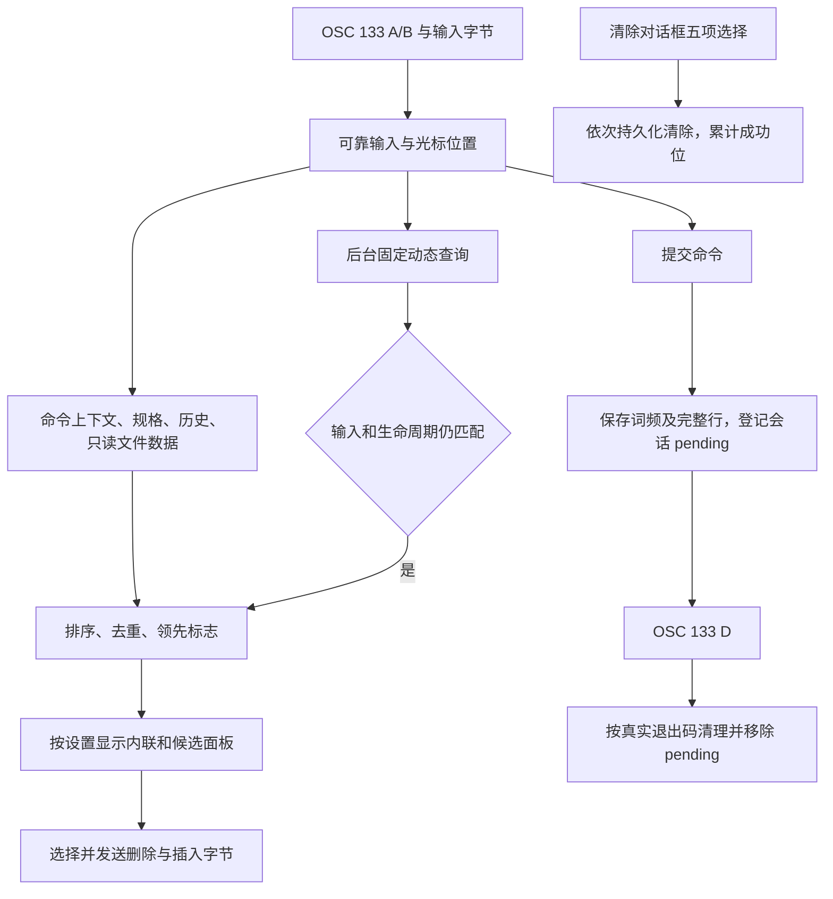

# 自动补全领域

## 目标与证据边界

本轮以本机 Otty 1.6.2 的发布产物为规格，重建“控制 → 自动补全”的设置、候选、历史学习和清除流程。
设置依据发布包中的 JavaScript，原生规则依据 REA/Hopper 反编译及限定地址的汇编，界面行为用真实窗口补充核对。
[原生证据](otty-native-findings.md)记录地址和 Evidence ID；[恢复合同与差异](otty-autocomplete-recovery.md)区分已恢复、已实现及未验证部分。
不能把规格条目数相同或测试通过解释为整个补全引擎完全一致。

## 领域概念

| 概念 | 含义与归属 |
| --- | --- |
| 配置 | `ControlConfiguration`；接受键、候选面板、内联建议、本地学习、敏感命令开关 |
| 查询 | `CompletionInput` 解析光标前的命令段；`CommandCompletionEngine` 计算候选，不执行 Shell 展开 |
| 候选 | 插入文本、显示文本、替换范围、来源、词频分、`clearLeader`；预览和接受字节分开建模 |
| 词频 | `CompletionLearningState.history`，以命令上下文及 token 为键 |
| 完整行 | `fullLines`，以工作目录和整条命令为键 |
| 自动探测 | `helpProbe`，自动 `--help` 得到的规格 |
| 目录学习 | `learnedFolder`，显式学习的项目命令 |
| 学习覆盖 | `learnedSpecs`，显式学习的 CLI 规格 |
| 持久化 | `CompletionStore` 维护五类数据；`AutocompleteService` 编排查询、学习和文件适配器 |

## 主要规则

接受键有 `tab`、`tab+right-arrow`、`right-arrow`、`ctrl+space`、`disable`，缺省 `tab`。
面板有 `disable`、`auto`、`escape`、`option-escape`，缺省 `escape`；最后一种同时响应 F5。
解析配置时去 Unicode 首尾空白、不区分大小写，并兼容原版解析器的别名。
内联建议、本地学习缺省开启；不记录敏感命令缺省关闭。

空输入不生成候选。自动面板允许单个候选；多项初始没有用户选择，方向键选择后才能用 Return 接受。
Tab 不负责选择首项：面板可见、未选中的单项会清理并消耗 Tab，不插字；普通多项则回退 Shell。
方向键或鼠标负责选择，选中后 Tab/Return 接受。面板隐藏且有合格 ghost 时可直接接受。
无 ghost 的 Tab 先查询，120ms 后仍无结果才补发一次 Tab；进入 Shell 接管后 Tab 和方向键继续交给 Shell，其他键解除。
Ctrl-Space 配置触发重新查询，不直接写候选。详细条件见 [Tab 原生证据](otty-tab-findings.md)。
`CompletionAcceptance` 按原始 token 的 Unicode scalar 数发送 DEL，再写完整文本；普通候选无条件加尾空格，目录、fix 和整行历史不加。
单独右箭头模式下 Tab 交还 Shell。内联和面板同时关闭时不查询候选，本地学习独立控制。

历史分数为 `storedScore × 0.95 ^ clamp(ageHours, 0, 720)`；再次使用保存 `decayedScore + 1`。
同一引擎对象已经见过的 `(context, token)` 查询时加 10，该加分不持久化，也不用于完整行。
首词使用全局上下文；以 `./` 或 `../` 开头的首词按工作目录隔离；参数使用已识别的命令和子命令路径。

整行历史仅在相同目录中按前缀匹配，先取最近 500 条，再按衰减分数和最近使用时间排序，截断到 20 条，最后移除与当前输入完全相同的行。精确相同行会先参与排序、名额和领先判定，移除后不重算领先标志。
首条至少领先第二条 0.5 且是匹配项中最近使用的，才有明确领先标志。
已知规格的候选先按是否有历史分、分数排序，再按子命令/别名、参数、选项、文件/目录排列，同级保留原顺序。
其静态构造分支不设置 `clearLeader`，也不将规格/文件/生成器没有提供的历史 token 插入候选。无规格的参数分支仅比较真正存在的历史分，领先阈值为 1.5 倍。命令名前缀分支仅利用词频重排，不追加全局历史 token，也不设置领先标志。
先构造完整行历史，再删除其他来源中的重复结果；明确领先的通用首项可排在历史之前。
唯一候选的内联显示由 UI 单独判断，不把唯一项等同于原生 `clearLeader`。

静态 Fig 规则以原版实际解码字段为界，详见 [Fig 实现](fig-completion.md) 和
[原生证据](otty-fig-findings.md)。只在 `-` 前缀枚举选项，按当前命令到根继承所有选项；
已使用选项仍可出现。命令的全部 `args.suggestions` 和文件模板取并集，不根据参数位置、
`isOptional`、`isVariadic` 或生成器脚本推断额外规则，也不拆等号值和短选项组合。

`AutocompleteNativeDynamicProvider` 在后台按固定命令分派，Git 使用原生恢复的八组只读 argv，
其他来源读取 package.json、本地 bin、Makefile、Compose、Cargo 和 SSH 配置。Compose 分派依赖已解析子命令链；当前快照仅 `docker-compose` 路径可达，`docker compose` 缺少后续规格，详见动态证据。
单命令最多 2 秒、整次最多 3 秒，取消结束进程组；没有候选或来源失败仍保留静态结果。
控制器以输入、目录、配置、prompt 和查询代次核对返回值。异步重排保留选中身份，身份消失
则取消选择，避免 Tab 或 Return 接受用户未选择的新项。具体条件和差异见 [动态补全](otty-dynamic-findings.md)。

学习发生在提交时，完成事件按会话身份取出 pending 记录并清理。127 删除该目录中的完整行及非选项 token；
其他非零状态仅删除不在该命令规格中的长选项，按 `=` 之前的名称判断，按原始 token 删除。
不根据输出中的 `command not found` 文本猜测退出码，也不将 126 转换为 127。
前导 ASCII 空格不学习。完整行还要求目录非空、去掉尾部空白后非空且不超过 2048 个 Unicode scalar。
敏感选项的参数不进入词频；“不记录敏感命令”额外控制完整行保存，属于前瞻开关，不清除已经保存的数据。

## 流程

## 设置页、更新与清除

`Resources/settings-ui/autocomplete.js` 是自有实现，经既有 WKWebView 桥接发送
`config_changed`、`update_completions_db` 和 `clear_autocomplete_data`。
设置先更新显示再发配置；Shell Integration 未开时提示但仍保存，不自动开启。

更新状态经 `window.__otty_completions_status` 兼容入口传入，包含 state/message/currentDate/specCount/lastCheckedAt/progress。
running 时显示进度，完成或失败后恢复按钮；进度限制到 0…1，错误显示在原处。
Aster 的传输仍使用自身更新服务，未恢复的原版网络协议列在差异文档中。

每次打开清除框都将 `history`、`fullLines`、`helpProbe`、`learnedFolder`、`learnedSpecs` 置 false。
未选时不能确认；取消或点遮罩不发请求；确认发送五个布尔值后关闭。
`capabilities.dataSync === true` 时隐藏整个清除行。
服务逐项清除，失败不撤销已成功的项，并继续处理后续项；内置规格不参与清除。

## 存储与迁移

新数据位于当前应用身份的 `Autocomplete/v2/`，与正式版和 Aster Dev 的身份隔离保持一致。
首次使用先备份旧学习文件，再建立空的新库和迁移标记，不导入旧权重、转移表或旧路径习惯。
旧原文件保留，CLI token/请求通道不变；备份失败不写完成标记，后续可重试。
损坏数据、目录和写入错误由存储边界向服务报告，不能静默覆盖损坏文件。

清除对每类使用独立持久化事务，发布的内存状态与写盘成功状态一致。
同时更新只保留一项任务；失败保留已安装的规格。已学习的规格覆盖和内置库分开存放。

## 保留的适配器与限制

Ghostty 原始 PTY observer、OSC 133、输入回显校验、Shell 别名/PATH 上报、文件转义与 CLI 协议保留。
Aster 旧的剪贴板、项目 Agent resume、命令转移加权、共享前缀、纠错及下一步注入已不接入新候选流程。
旧 Core 类型仍供其他功能和历史测试使用，不是新运行期引擎。

规格快照含 711 条公开 Fig upstream 记录，日期 2026-10-05，revision `aef52acff84c`；转换来源和 SHA-256 见
[第三方说明](../../THIRD-PARTY-NOTICES.md)。17,517 个命令节点、67,994 个选项、40,173 个参数、40,435 个
静态候选完整保留。原版忽略的 Fig DSL 扩展字段不构成实现缺失；动态一致性按固定原生分支逐项验证。
文件、README 和 help 探测的边界、远程 Shell、面板像素及 Shell 编辑兼容性不能由这次静态恢复推导为全等。

## 验证

使用 `./scripts/test.sh --no-parallel --filter '<具体功能模式>'` 定向运行 Core、存储、设置桥接和终端控制器测试。
`CompletionRulesTests`、`CompletionHistoryTests`、`CompletionServiceStorageTests`、`CompletionStoreTests`
覆盖恢复出的排序、学习、失败清理、迁移和部分成功语义；`AutocompleteSettingsWebTests` 覆盖真实 WKWebView 状态与渲染。
运行了哪些测试、真实窗口验收及尚未验证的部分以恢复报告为准。全量测试只在用户明确要求时运行。
