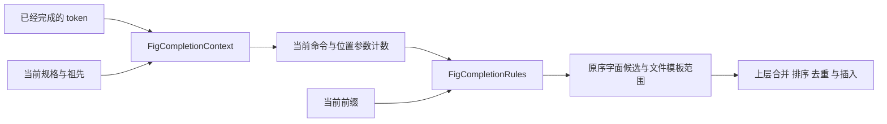

# Fig 静态补全规则

> 归档说明：Hopper 原库、关键反编译输出、SHA-256 清单和重开步骤已整理到 [Otty 1.6.2 分析存档](otty-analysis/1.6.2-0fa10277/README.md)。本文中的 `.build/rea/`、任务 worktree 路径与 PID 为历史记录；续查时使用存档中的同名文件，不能当成当前运行状态。

这份文档说明 Aster 对 Otty 1.6.2 实际使用的 Rust 静态规格路径的重建。目标是重现已发布程序消费的数据和规则，不把完整 Fig DSL 的理论语义当成 Otty 已实现的行为。动态来源、终端按键与学习排序分别由它们自己的领域模块处理。

## 数据与证据边界

规格来自 Otty 发布资源 `completions-client.db.lzma` 中的公开 Fig 数据。导出脚本要求全部记录的 `source=upstream`，并验证元数据、SQLite 完整性和 `spec_i18n=0`；遇到混入其它来源或翻译覆盖时拒绝导出。没有导入 Otty 的应用实现代码。

当前快照为 `aef52acff84c`，日期 `2026-10-05`，711 个顶级命令。转换后保留以下全部静态节点：

| 节点 | 数量 | 旧转换器丢失数 |
| --- | ---: | ---: |
| 命令及子命令 | 17,517 | 22 |
| 选项 | 67,994 | 244 |
| 参数 | 40,173 | 91 |
| 静态参数候选 | 40,435 | 10,108 |

旧转换器按 Shell token 白名单删除了含空格、Unicode 或通配符的字面名称，例如 `curl -H` 的 `Content-Type: application/json`。它还把四处 pip/pipenv 的 4,004 项列表截成 2,000 项。这些过滤和截断均已移除；空名称、原始描述换行、连接符和完整长文本也被保留。

规则来源是已发布二进制的静态分析，不把它表述为实时执行观测：

- `ev_0e28c28363924fca79310f58ffc3c85116195628abcbde54df775a4381737610`：`parse_context`、选项枚举、子命令标记、文件模板辅助路径。
- `ev_f91566a79569652dfbd08300fac92ed30922cdd3b7d3b2d67e80e2b6bc446c15`：规格反序列化路径。
- `ev_8ce5139646efbd204c0bad3cd84deb009db4b00c92ac0a2ce6408d9e72c848d8`：字段分类器与选项反序列化；未知字段明确跳过。
- 同一二进制切片的 LLVM 指令核对用于消除伪代码歧义；本地产物清单在 `.build/rea/fig-rules-provenance.json`。LLVM 核对本身不是新的 REA Evidence。

## 原生消费的字段

| 对象 | 生效字段 |
| --- | --- |
| 命令 | `name`、`description`、`subcommands`、`options`、`args`、`aliases` |
| 选项 | `names`、`description`、`args` |
| 参数 | `name`、`description`、`template`、`suggestions` |
| 静态候选对象 | `name`、`description`；字符串形式也是一个候选 |

`hidden`、`isRepeatable`、`isPersistent`、`isOptional`、`isVariadic`、`exclusiveOn`、`dependsOn`、`priority`、`separator`、`parserDirectives`、`filterStrategy` 和 `generators` 不参与这条 Rust 静态路径。Aster 现有 Codable 模型保留部分字段以读取既有文件，但新规则不使用它们改变候选。

## 解析与枚举



`FigCompletionContext(root:completed:)` 只接收可执行命令之后已经完成的 token，不把正在输入的最后一段提前消费。它保存当前命令、从根到最近父级的祖先、规范命令路径以及位置参数计数。

以 ASCII `-` 开头的 token，在当前命令到根的选项列表中按完整名称、大小写敏感的 UTF-8 字节匹配。找到选项后，按 `args` 数量跳过随后的 token；没找到就只跳过该 token。`--` 不终止选项解析，`-ab` 不拆成组合短选项，`--name=value` 不拆成名称和值，除非整段本来就是一个声明的选项名称。

其它 token 按子命令主名称或别名精确查找。匹配后进入子命令并把位置参数计数归零；未匹配时计数加一。已经出现位置参数并不阻止后续子命令下钻。

静态枚举遵循以下规则：

- 名称和当前前缀分别做 Unicode lowercase，然后按 UTF-8 字节比较前缀，不进行 Unicode 规范化。返回文本保留原始大小写和描述。
- 子命令只列 `name`，不展开别名。别名数组含精确字符串 `hidden` 的子命令被隐藏；JSON `hidden: true` 没有这项作用。是否处于可列子命令的位置由调用方根据 `positionalCount` 判断。
- 选项按当前命令、最近父级、直至根的顺序枚举每个 `names`。所有父级选项都继承，已使用的选项也不会因此消失。这里不去重；上层可以按原版的合并规则保留最先产生的同名项。
- 当前命令全部位置参数的 `suggestions` 合并枚举，不按位置参数索引选择，也不改用上一个选项的 `args`。
- 当前命令全部参数的 `template` 取并集。精确 `folders` 启用目录，精确 `filepaths` 启用文件和目录，其它名称忽略。选项参数的模板、参数名称中的 `path`/`file` 等词不影响这一步。含 ASCII `/` 的前缀另外启用通用文件和目录补全；仅 `~` 不触发此条件。

## 实现与导入限制

`Sources/AsterCore/fig-completion-rules.swift` 提供纯规则接口，不依赖 AppKit、文件系统或命令执行。`Autocomplete.swift` 保留既有规格模型和导入边界。终端插入编码、文件枚举以及多来源排序由上层负责；规则函数本身不执行规格中的任何脚本。

导入仍有明确的 Aster 预算：文件最多 32 MiB、描述最多 16 KiB、字面名称最多 512 字节、单参数最多 10,000 个静态候选。超出预算拒绝导入，不默默截短；当前 711 条快照均在预算内。顶级命令名和 help 输出解析仍使用原有严格校验，Fig 字面节点使用独立校验。名称拒绝 ASCII 控制字符（发布数据中存在的 Tab 除外）和 DEL，描述只按长度限制并作为显示文本保存。这些是导入边界，不应声称原生程序具备相同的全系统限制。

旧兼容模型仍记录部分 `generatorScripts`：1,819 个源生成器中有 1,728 个可表示为该数组。原生静态解码明确忽略 `generators`，所以这不属于静态候选缺失；动态来源是否一致须通过独立动态模块的证据和测试判断。

## 重建与验证

```sh
python3 scripts/export-fig-upstream.py \
  /Applications/Otty.app/Contents/Resources/completions-client.db.lzma \
  .build/rea/fig-upstream.json
node scripts/build-fig-specs.mjs \
  --input .build/rea/fig-upstream.json \
  --out Resources/autocomplete/fig-specs.json
node --test Tests/Support/fig_specs.test.mjs
./scripts/test.sh --filter 'figContext|figRules|figStore|figSnapshot|figScoped'
```

导出路径必须不存在，避免误覆盖已留存证据。`--source-date` 和 `--source-revision` 可显式指定元数据；离线模式不联网、不执行输入代码，也不合并旧中文覆盖。

`FigRulesTests.swift` 覆盖精确选项消费、祖先继承、子命令下钻、`hidden` 别名、Unicode 字节前缀、静态参数合并、文件模板和导入预算。`FigDatabaseTests.swift` 验证全部静态节点数量及典型长列表和描述。Node 测试验证转换保持字面值，以及失败时保留之前的输出文件。测试通过和真实终端显示验收应分别记录。
