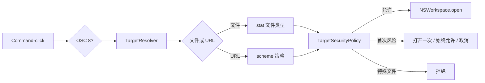
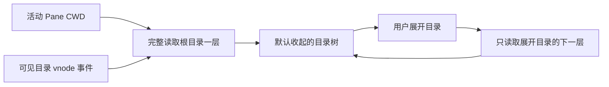
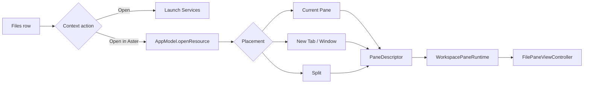

# 文件、链接与 File Pane 领域

## 业务背景

终端输出同时包含本地路径、普通 URL 和程序通过 OSC 8 标注的显式链接。它们均属于不可信输入：Aster 必须先解析、规范化和授权，再交给系统应用，不能沿用终端组件直接调用 `NSWorkspace.open` 的默认路径。

## 领域概念

- **DetectedTarget**：已规范化的文件或 URL，不包含打开动作。
- **TargetResolver**：解析绝对、`~/`、相对、`path:line[:column]`、`file:` 和其它 URL。
- **LinkSchemePolicy**：普通文字采用“全部”或“标准 + 自定义”检测；OSC 8 始终可识别。
- **TargetSecurityPolicy**：普通文件放行；外部网站、非标准 scheme 和可执行文件首次确认；特殊文件拒绝。
- **Security Exception**：分别记住用户在本机确认的网站 host、非标准 scheme 和可执行文件身份签名。
- **WorkspaceResourcePlacement**：资源进入 Current Pane / New Tab / New Window / 四向 Split 的统一落点。
- **WorkspaceResourceOpenMode**：Files 使用 `automatic` 按展示能力选择 editor/preview；CLI 保持显式 view/edit。
- **FileDocumentSession**：由 `WorkspacePaneRuntime` 持有的 UTF-8 文档缓冲、dirty/read-only/error 状态。
- **FilePresentationKind**：Markdown、reStructuredText、HTML、SVG、图片、PDF、富文档、diff、Agent transcript、源码和二进制。
- **WorkspaceFileActionService**：Files 菜单创建、重命名和移入废纸篓的唯一写入边界。

## 核心规则

1. 原始目标最多 4096 UTF-8 字节且不能含控制字符。
2. 相对路径只以活动 Pane 最近一次可靠 OSC 7 CWD 为基准。
3. `file:` URL 转为文件目标，不能绕过文件类型检查。
4. OSC 8 不受自动检测白名单限制，但仍需打开授权。
5. FIFO、socket、设备和未知文件类型不得打开或预读。
6. 网站与 scheme 例外小写去重；可执行授权绑定文件身份，文件变化后重新确认；配置导入会剥离全部本机授权。
7. Files 打开使用 `automatic`：Markdown、reStructuredText、HTML、SVG 和普通源码恢复为 `.editor` 且默认可编辑；图片、PDF、富文档、diff、Agent transcript 与二进制恢复为 `.preview`。CLI 的 `view` / `edit` 与新建文件的显式 `edit` 不受影响。
8. 文件名拒绝空值、`.`、`..`、路径分隔符、控制字符和超过 255 UTF-8 字节的值；创建不覆盖同名项。
9. Rename 只在同一父目录内移动，并同步所有已打开文件及目录后代 Pane；删除只调用系统 Trash。
10. Source/Preview、锁定、语言与预览缩放属于运行态，不改变既有 `.editor` / `.preview` 快照格式；软换行与行号跟随编辑器配置。

## 业务流程

### Files 目录快照与主题

本地 Files 根目录来自当前 Tab 的活动 Pane CWD，目录变化事件携带的新目录直接作为请求参数。
刷新、隐藏项切换与文件动作后的重读使用最新 `requestedFilesDirectory`，不能优先回读旧快照的
`filesDirectory`。每个结果经取消状态、Tab、Pane、目录及隐藏项参数校验后才能替换列表；切换
目录期间保留旧画面并拦截旧动作。

`WorkspaceFileTree.children` 完整读取单层，不使用递归全树的 500 项预算；
`DetailsFileTreeSnapshot` 只合并已展开目录，表格投影也不再截取前 2000 项。隐藏项默认过滤，
开启后隐藏目录同样按需展开；逻辑 CWD 可以是目录符号链接，树内符号链接仍作为叶节点，
防止递归越界与循环。Find 只过滤已读取节点，不为搜索扫描整棵磁盘目录。

`FileSystemDirectoryWatcher` 只观察根目录与当前展开的目录，150ms 合并事件后异步刷新。
离开 Files 或收起 Inspector 时取消任务并释放监听，重新进入时重读同一目录；不能只以
CWD 相同判断快照有效。监听建立失败仍允许读取，下一次进入时重试。

配色对齐 Otty 1.6.2 的 `DetailsFilesView` 本地行：`folder` / `doc` 的 tint 共用
`accentColor`，名字共用 `textPrimary`；Aster 分别映射为动态 `AsterTheme.accent` 与
`AsterTheme.ink`，本地和远端共用，不固定为 `#5FABF3`。现有归档位于
`otty-analysis/1.6.2-0fa10277/local/rea/otty-1.6.2-0fa10277.hop`，同 SHA arm64
静态反汇编中本地行入口为 `0x1007080f0`，名称设色为 `0x10070877c`，图标设色为
`0x1007088a8`；这些是静态证据，不代表已观察 Otty 运行态。

验证：`DetailsFilesDirectoryTests` 覆盖大子目录、超过 2000 个根节点、切换隐藏项的目录竞态、
重开刷新、深层及隐藏目录、符号链接根和 vnode 更新；`DetailsFilesAppearanceTests` 检查真实
AppKit 行在明暗外观下的图标与名称色，可用 `ASTER_FILES_UI_EVIDENCE_DIR` 导出截图。

### Files 到 File Pane

Files 的右键菜单保持固定结构：`Open`、`Open in Aster` 子菜单、创建/重命名/废纸篓、路径复制和 Finder。树展开仍由 chevron 或双击负责，不混入资源动作。`Copy Relative Path` 以当前 Files 根目录按 path components 计算，不用字符串前缀，也不添加 `./`。

File Pane 顶部使用 32 pt 工具栏，负责模式、预览缩放、Send to Chat、运行脚本、Open In、保存状态与关闭；文件名由活动 Pane 的外层标题承载。Markdown、reStructuredText、HTML 与 SVG 显示 code/eye 胶囊，默认 Source，可切换 Preview；普通源码显示 code/lock 胶囊，默认可编辑，可就地锁定。预览专用类型不显示无效模式开关。Markdown 由固定版本 `swift-markdown` 解析 GFM 后在禁用 JavaScript、禁用网络的 `WKWebView` 中展示；HTML/SVG 使用同一沙箱。源码由 HighlighterSwift/highlight.js 着色，同时保持原生 `NSTextView` 输入语义。图片使用可缩放 `NSScrollView`，PDF 使用 PDFKit，Office/媒体/字体交给 Quick Look，二进制使用 `NSTableView` 按可见行生成有界 hex。可信 Agent transcript 只复用已发现历史的解析结果，并提供 Resume/Fork；任意 JSONL 不会自行升级为会话。

每个 `WorkspaceViewController` 持有一个 `FileRenderPipeline` actor。语法高亮、Markdown 与 reStructuredText 转换在该串行后台边界完成，只把 RTF `Data` 或 HTML `String` 返回主线程；revision guard 会丢弃编辑后迟到的旧结果。`NSTextView` 与 `WKWebView` 在 Pane 生命周期内缓存复用，Source/Preview 和锁定切换只更新层级与编辑状态，不再重建整个工作区、WebKit 实例、选区或 undo 状态。 源码文本视图显式启用纵向伸展并设置最大尺寸，在 Pane 布局后按滚动区 viewport 更新最小尺寸；换行模式跟随可用宽度（扣除文本内边距），关闭换行时允许长行扩展并横向滚动。首次挂载、恢复和模式切换期间出现的零尺寸不写入文本容器，避免已加载文本因布局边界而不可见。源码文本视图从创建起就用 TextKit 1（`usingTextLayoutManager: false`）：行号标尺依赖 `NSLayoutManager`，默认的 TextKit 2 会在标尺首次绘制时被中途切换，切换前按零宽排出的折行会残留到语法高亮整篇重排后才消失，表现为切换标签后正文挤成一条窄列。视口宽度就绪前文本容器不跟随零宽 frame，避免容器宽度为负、整篇按每字一行排版。

Pane 通过目标文件父目录的 vnode 事件检查 `contentModificationDate`，同时覆盖原位写入和 atomic replace；只有目录监听无法建立时才回退为带 tolerance 的一秒检测。没有本地改动时自动重载；存在 dirty 内容时显示 `Modified on Disk`，由用户从源码右键或 Web 预览的 Reload 明确确认后才丢弃内存内容。保存继续使用 `DocumentBuffer` 原子替换，读取只接受普通、非符号链接文件，编辑缓冲上限仍为 10 MiB；超大或二进制预览只读取有界前缀。

活动 Pane 是 Editor / Preview 时，`⌘F`、命令面板与标题菜单的“查找”由 `AppModel.toggleFind` / `presentFind` 经 `fileFindRequested` 按 Pane ID 转给该 File Pane，不打开终端查找栏。`FilePaneFindBar` 插在工具栏与内容区之间，每次查找都从当前内容树重新解析目标（`FilePaneFindTarget`），Source/Preview 切换后自动作用于新视图：源码 `NSTextView` 由 `AsterCore.DocumentTextSearch` 以 UTF-16 区间计算全部匹配（支持区分大小写和正则，零长度正则匹配跳过，最多 1 万处），选中、滚动并显示系统查找指示器；Markdown/HTML/SVG 预览与 Agent transcript 用 `WKWebView.find`，WebKit 不给总数，只显示是否命中；PDF 用 PDFKit `findString` 并缓存结果。Web 与 PDF 不支持正则，开关置灰。图片、二进制和 Quick Look 富文档不提供查找。查找栏属于 Pane 运行态，不写入快照。

### File Pane 工具栏与右键

`FilePaneToolbar` 将布局和文档状态与控制器分开：46×22 pt 模式胶囊使用源码/预览或编辑/锁定图标；小于 280 pt 时保存、放弃、已保存、Resume、关闭收为图标，仍保留可访问名称。可编辑且 dirty 时显示保存/放弃并隐藏关闭，clean 时显示禁用的已保存；预览/只读状态不显示保存组。窗口关闭和 `⌘W` 仍经过既有保存确认。文件工具栏关闭先激活所属 Pane，避免关闭另一个分屏。

源码右键由 `FilePaneMenus` 构建剪切、复制、粘贴、全选、撤销/重做、语法和读盘重载，最后是发送到 Chat。只读状态禁用剪切/粘贴，隐藏撤销/重做与重载；撤销/重做动作显式通知文档 delegate，避免只还原画面而保存旧缓冲。语法列表由当前后台高亮器提供，手动选择后勾选；Auto-detect 仍使用文件扩展名和高亮器探测。未知语法或高亮失败会返回当前主题的纯文本，清除上一次手选语法的颜色。可信 Agent transcript 支持源码 JSON/JSONL 与 Agent History 切换，预览工具栏有 Resume；Fork 保留在会话内容区。

`FilePreviewWebView` 保留 WebKit 原生菜单，在最后一个复制/剪切/粘贴项之后插入去重的 Chat 项。WebKit Reload 改绑为文档读盘、dirty 确认、清除撤销历史和重新渲染；不直接刷新临时 HTML。图片、PDF 与 Quick Look 外层预览菜单由 `FileNativePreviewMenus` 构建复制/全选、Chat 和文件动作；Quick Look 内部预览由系统进程提供，其内部菜单仍受系统版本和格式影响。

Open In 与原生预览公共文件菜单共用 `FilePaneFileActions`：在访达中显示、复制绝对路径、使用默认应用打开和 Open With。后者使用系统关联应用的返回顺序，最多 20 项；不改变默认应用。打开失败显示错误，特殊文件拒绝打开，可执行文件继续确认。

JSON（`.json`、`.geojson`；`.jsonl` 仍按源码或 transcript）在 `FileDocumentClassifier` 中归为 `.json`，走与 Markdown 相同的 Source/Preview 双形态，Preview 是原生 `FileJSONTreeView`（`NSOutlineView`）而非 WebKit。解析在 `FileRenderPipeline` actor 中由 AsterCore 的 `JSONDocumentParser` 完成：不用 `JSONSerialization`，以保留键顺序、重复键和数字原文；解析用显式栈而非递归，因为后台线程栈只有 512 KiB，几百层嵌套的递归下降会栈溢出；嵌套上限 512 层，限制的是仍按层递归的节点释放与序列化。结果以 `.jsonTree` / `.jsonInvalid` 值类型跨 actor 返回，过期修订按既有 revision 丢弃。树节点 `JSONTreeItem` 在展开时才创建子项；树从 `root` 行开始，非空容器的最后一个子项是闭合括号行，`JSONOutlineView.frameOfCell` 把它左移一级与父行文字对齐，且不可选择；容器行文字随展开状态在 `{` 与 `{…} N 项` 之间切换，展开/折叠通知只重载该行。配色取主题 ANSI（键 1、字符串 2、数字 4），布尔与 null 用正文色，标点用半透明正文色。重渲染按位置标识恢复展开状态（对象允许重复键，所以不按键名）。顶层超过 50 项时不自动展开，避免长数组首屏卡顿。树视图暂不接入查找栏。

格式化由 `JSONDocumentFormatter` 完成：先完整解析校验，再只重排 token 之间的空白，字符串、数字和字面量逐字节照抄，所以 `\u4e2d` 转义、大整数和 `1.0` 不被改写；缩进单位取第一条有缩进行的前导空白（tab 或 1–8 个空格），找不到用 2 空格。写回走 `FileSourceTextView.replaceAllText`（`shouldChangeText` → `replaceCharacters` → `didChangeText`），因此进入撤销栈、文档标脏，不会自动保存；解析失败只经 `model.notice` 提示行列。工具栏“格式化”仅在 `.json` 的可编辑 Source 中显示。

图片和 SVG 预览支持倍率、放大/缩小、实际大小和适应窗口；预设为 25/50/75/100/150/200/400%，步进 ×/÷1.25、范围 0.1…16。Markdown、RST、HTML 和纯源码不显示倍率按钮；预览倍率不改变源码字号。仅本地 `.sh` 显示 Run：`AppModel.runShellFile` 创建以脚本父目录为 CWD 的新终端，通过已有就绪命令队列执行 `bash` 加安全转义路径。Run 执行磁盘版本，未保存稿留在原 Pane；远端或非 `.sh` 拒绝。

布局和菜单证据来自现有 Otty 数据库所对应的同 SHA arm64 切片：toolbar `0x1000c2f00`、状态 `0x1000c3670`、源码菜单 `0x1000ca1f0`/`0x1000b7be4`、Web 菜单 `0x1000f1e28`、QL 菜单 `0x1000ac614`、公共动作 `0x1000fd114`、Run `0x1000e2044`。新补证是 LLVM 指令核对，并非新的 REA/Hopper 伪代码导出；不能据此声称实际 Otty 窗口逐像素验收完成。Swift 枚举元数据已恢复 DualMode 的 markdown / rst / svg / html 顺序，kind==2 对应 SVG；倍率按钮因此仅用于 SVG 和图片。

验证入口：`FilePaneMenuTests`、`FilePaneToolbarTests`、`FilePaneJSONTests` 与 AsterCore 的 `JSONDocumentTests`，连同原有主题、布局、查找与 Chat 测试定向串行运行，避免并发 AppKit 窗口/全局焦点干扰。

### File Pane 文字主题、行号与 Chat 选区

- `FilePaneStyle` 消费当前 `TerminalTheme` 的终端正文色、渲染背景色与 ANSI 色。
  源码的默认文字和插入文字使用正文色，高亮类别通过 CSS 映射到当前 ANSI 调色板；
  `FileRenderPipeline` 仍在后台 actor 内渲染，提交前同时校验 revision、文本与主题。
  Highlighter 的小型 CSS 入口补丁见 `Vendor/HighlighterSwift/UPSTREAM.md`，不修改内置主题文件。
- Markdown / reStructuredText / HTML / SVG 与会话记录的自有文字预览使用同一主题快照，
  主题切换时更新缓存视图，保留当前文档与编辑选区。Quick Look 只设置背景和 Aqua / Dark Aqua
  外观，内部文字仍由系统预览器控制，不能保证每种外部格式采用完全相同的正文 RGB。
- 源码的 `FileLineNumberRuler` 读取 `editor.showLineNumbers`，配置变化即时生效。
  行号属于滚动标尺，不写入文档、剪贴板或撤销栈；只给逻辑行编号，折行不产生新行号。
  文本布局使用 `NSClipView.bounds` 扣除标尺占据的负 x inset，不能把包含标尺占用的
  `NSScrollView.contentSize` 当作可用宽度。滚动时只定位并绘制可见逻辑行。
- File Pane 工具栏和源码右键的 Send to Chat 捕获当前视图选区，而不是重读磁盘。
  源码快照包含路径、UTF-16 选区对应的行范围与未保存文本；网页预览读取渲染后的 DOM 选文。
  无选区时只提供文件引用，不自动附上全文。入口不切换当前 Pane，也不直接写入目标。
- `AgentChatSendSheetController` 展示冻结快照、目标和 Comment；Copy Message 只复制当前
  勾选的消息，Send 经过 `AgentChatContextBuilder` 清理、脱敏与字节预算后预填到选定的
  已有 Agent / 终端。目标按 Tab / Pane UUID 和 provider 重查；关闭、退出或 provider 改变时拒绝写入。
  不追加提交回车；没有运行中的目标也可先复制消息。文件浏览器原有的整文件 Composer
  入口保持独立，不与 File Pane 的选区发送混用。

Otty 参考为现有 `otty-analysis/1.6.2-0fa10277/local/rea/otty-1.6.2-0fa10277.hop`
及同 SHA 输入切片。已通过 Hopper 原生界面直接打开该既有数据库，读取
`handleSendToChat:`、`sub_10011e5f0`、`sub_10010dec4` 的伪代码和行号配置符号；
数据库关闭前后 SHA 一致。REA MCP 的旧会话锁未恢复，原生读取不冒充 MCP Evidence。
已确认 TextSurface 从渲染快照取得正文色与 palette，配置项为
`editorShowLineNumbers`；源码 Send to Chat 携带 URL、选文和行号，无选区不等于全文。
Otty 的 Quick Look 只显式设置背景与外观；Aster 自有 HTML 正文色属于本项目的主题映射。
数值 token 类别的原始名称与原版已有 Agent 的提交参数未完全恢复，不宣称逐类别或发送策略完全相同。

验证入口：`FilePaneThemeAndEditorTests`、`FilePaneStyleTests`、`FilePaneChatSheetTests`、
`FilePaneLayoutTests` 和既有 File Pane / Chat 定向用例。设置 `ASTER_FILE_PANE_EVIDENCE_DIR`
可导出真实 AppKit 源码画面和 WebKit renderer 预览截图，复制测试使用隔离剪贴板。

## 关键实现与失败语义

### 链接协议设置交互

网页卡片按本机 Otty 1.4.1 的链接协议交互对齐，保留“全部 / 自定义”、按需显示的配置入口、独立预览开关和安全提示重置。`Resources/settings-ui/link-protocols.js` 只负责逐行输入、增删、错误反馈、焦点和串行提交；它依赖设置页传入的提交函数，不访问文件或授予打开权限。有效协议即时保存，空行不入库，`Escape` / 完成在保存结束后关闭；无效输入或明确保存失败保持在编辑器内，允许修正和重试。对话框限制焦点范围，关闭后恢复到重建后的配置按钮。

`LinkSchemePolicy.normalizedCustomSchemes` 统一大小写、可选 `://` 后缀、去重和 64 项/每项 64 字符边界，非法或超限输入整批拒绝。该字段的原生输入上限单独覆盖最大合法列表，不扩大其它文本字段的 4096 字节上限。网页设置写入不再订阅自身变更重复推送快照；显式快照之后发送带 requestID 的 `mutationResult`，逐行编辑器等待回执后提交最后一次输入，避免旧 revision 拒绝连续输入。

重置将网站、非标准协议、可执行文件签名三类例外一次清空，保留检测列表与预览设置；网页收到成功回执后才显示“已重置 ✓”，反馈状态独立于 DOM，在快照更新后仍保持 1.6 秒。`GhosttySurfaceView` 的协议策略变更主动作废命中缓存并更新预览，重新启用预览时按现有鼠标位置恢复。手形与实际点击命中共用判断，不依赖预览开关；失去 Command、离开链接或禁用协议后恢复终端指针。

验证入口：`LinkProtocolSettingsTests` 覆盖实际 WKWebView 输入、持久化、焦点、重置及下一次确认；`GhosttyLinkHoverE2ETests` 通过真实 surface 与 NSEvent 验证指针、预览开关和点击（打开动作使用安全替身）；`GhosttyCommandClickTests` 在开启 SGR 鼠标上报的真实 surface 上验证 Command 点击链接不写入 PTY、只请求打开一次，拖出阈值后按下与抬起成对交还程序；`DetectedTargetTests` 覆盖标准协议、OSC 8 与配置边界。测试提供 `ASTER_LINK_UI_EVIDENCE_DIR` 可选截图目录，仅使用隔离 defaults。

`flagsChanged` 必须按事件携带的 Command 修饰状态同步整个链接交互，不能只处理物理键码 54/55：系统重映射或合成事件可能保留其它键码。原先预览按修饰状态更新、手形和下划线按键码更新，会出现“有 URL 预览但没有手形和下划线”。回归使用 `[HPM] Proxy created: /api  → http://127.0.0.1:8899`，先停住鼠标再发送左右 Command 和非标准键码的 Command 状态事件，验证目标处下划线、手形与预览同步出现，松开后清除。

原生 `mouse_over_link` 命中单独保存在 `nativeHoveredLink`，与预览开关解耦，并和文字扫描共同驱动手形；OSC 8 的显示文字可能不含 URL，不能用文字扫描失败否定原生命中。鼠标点击、滚动和移动经同一事件坐标更新缓存，避免原生预览位置已变化、Aster 仍命中旧位置。松开 Command、离开视图、失去键盘焦点或销毁 surface 时清理命中，迟到的原生回调不得重新显示预览。Command 点击打开链接后，确认弹窗或被激活的浏览器会成为 key window，松开 Command 的 `flagsChanged` 送不到终端；因此窗口失活（`setWindowActive(false)`）与 `resignFirstResponder` 都按「Command 已松开」收尾，否则下划线、手形和预览徽章会一直留在终端上并随输出刷新。下划线通过 `CAShapeLayer` 直接合成到 Metal 宿主中，关闭隐式动画并同步更新路径，不依赖透明 `NSView.draw` 的调度；已在独立测试窗口的真实画面中核对代理 URL 下划线可见。

按下 Command 时每次从窗口读取当前指针位置，不能只在缓存为空时读取；测试通过 `linkPointerLocationProvider` 注入位置，以免合成事件未移动系统指针而掩盖此差异。回归会故意留下错误缓存再按键，确认手形与预览使用新位置。鼠标跟踪仍采用 AppKit 的 [NSTrackingArea 事件机制](https://developer.apple.com/library/archive/documentation/Cocoa/Conceptual/EventOverview/TrackingAreaObjects/TrackingAreaObjects.html)。

`AsterTerminalView` 在点击发生时读取当前终端单元格的 OSC 8 payload，以精确区分显式链接和同值普通文字；`InlineURLDetector` 补充 SwiftTerm 固定 scheme 列表之外的 `scheme://`。自定义 URL 跨物理行时，会在可见区内按占满右边界的连续行重建，最多 8 行和 4096 字节；超出边界时拒绝截断打开。预览文字与实际打开共用 `TargetResolver` 和 Session 当前可信本地 CWD，因此相对路径、`~/`、`file:` 与行列后缀会显示成可核对的绝对路径；远端主机 OSC 7 不会被伪装成本机路径。底部预览使用独立圆角 badge：浅色外观固定为半透明黑底白字，深色外观反转为半透明白底黑字，只跟随系统明暗外观，不读取终端主题或 ANSI 颜色。Ghostty 主引擎下 `link-url` 固定关闭，普通文字 URL 与路径只有 Aster 一条通道：`TerminalInlineTargetScanner`（AsterCore）逐行切出 URL（`scheme://`、`mailto:`）与路径 token（绝对、`~/`、`./`、相对以及 `Makefile` 这类裸文件名，剥离 `@` 前缀、旗标、尾随句读，只接受 `:line[:column]` 形态的冒号）；`GhosttySurfaceView+Links` 把候选映射回终端列（含宽字符第二列），URL 按 `LinkSchemePolicy` 过滤，路径经 Session 提供的 `linkPathValidator`（`TerminalTargetOpenCoordinator.fileTargetExists`，按当前可信本地 CWD 解析后 stat）确认存在才采信，Command 按住期间结果有界缓存，CWD 变化即作废。Command 按下时扫描整个视口，用不参与命中测试的 `GhosttyLinkUnderlineOverlay`（zPosition 高于 CAMetalLayer）画实线下划线，输出、滚动、尺寸变化合并重扫，松开或指针离开即清除；Command 状态取自事件本身而非全局修饰键，便于合成事件测试。Command 悬停时手形指针由 Aster 设置；修饰键按下时立即按窗口当前指针位置重算命中，即使鼠标静止也显示手形。AppKit 在 `NSCursor.set()` 或视图层级变化后会自行合成 `cursorUpdate` 事件，其 `modifierFlags` 在 Command 按住时也为空，因此 `cursorUpdate` 只按当前状态重施指针形状，绝不作为修饰键状态来源（否则按下约 30ms 后下划线与手形即被清空，而预览仍在）。底部预览徽章为紧凑规格：28pt 高、12pt 等宽字；宽度按 cell 尺寸计算并禁用省略号，只有地址超过 Pane 可用宽度才中间截断。Ghostty 的 mouse_shape 在悬停期间只记录不应用，悬停结束后恢复。Command 点击在 mouseDown 锁定归属，命中判断与手形相同（OSC 8 原生命中优先，其次 Aster 侧识别）：命中时整次点击归 Aster，PRESS 与 RELEASE 都不交给 Ghostty；抬起时仍按着 Command 且位移不超过 4pt 才以主队列异步方式打开，拖出阈值则在按下位置补发 PRESS，交还 Ghostty 拖选。未命中的点击照常交给 Ghostty，OSC 8 仍可经原生 `open_url` 进入同一协调器，Aster 不在抬起时再识别一次。必须在按下时拦截：开启鼠标上报的程序（如 Claude Code 全屏）从 SGR 上报里看不出 Command（协议不编码 Super），识别到 Ghostty 后会把点击当作打开请求、自行打开链接；点击若同时交给程序，浏览器会在 Aster 的确认框之前打开。预览仍是双来源：OSC 8 由 Ghostty `mouse_over_link` 原生上报并优先显示，普通文字目标由 Aster 侧识别；原生空清除信号只清原生预览并立刻按最近指针位置补一次 Aster 侧识别；badge layer 显式抬高 zPosition。`TerminalTargetOpenCoordinator` 负责终端目标；Files 的系统 Open 在再次 stat 后沿用同一特殊文件拒绝与可执行确认规则。控制页分别保存链接、文件与文件夹目的地：本地普通文件和目录选择 Aster 时由所属 `WorkspaceTab` 新建 Editor / File Browser Pane，HTTP(S) URL 新建 Web Pane，系统目的地继续交给 LaunchServices。Web Pane 的快照与 Recipe 只接受带 host 的 HTTP(S) URL，不开放脚本桥、本地文件或自定义协议；自定义应用只保存显示名和 bundle ID，每次使用时由 LaunchServices 重新定位，不固化可能失效的 `.app` 路径。SSH 远端文件由详情面板的远端模式单独承载，见下面的「远端文件与传输边界」与 [Inspector Details Panel](details-panel-domain.md)。

解析失败、用户取消或系统无对应应用均返回失败且不写例外。外部网站、非标准 scheme 与可执行目标的“始终允许”分别绑定 host、scheme 和文件路径/设备/inode/大小/修改时间签名；可执行文件发生替换或修改后旧授权不再匹配。特殊文件直接拒绝，配置导入统一剥离这些本机授权。测试位于 `FileDocumentTests.swift`、`WorkspaceFileActionServiceTests.swift`、`FilePaneViewControllerTests.swift`、`WorkspaceDetailsPanelTests.swift`、`DetectedTargetTests.swift`、`AppKitMigrationTests.swift` 和 `WorkspaceBehaviorTests.swift`。

### 远端文件与传输边界

详情面板的远端模式（Files 页）提供远端目录的只读浏览加上传/下载。它与本节的 File Pane 链路是
两条独立管线，不能互相借用：

- 远端条目**不生成 `DetectedTarget`，也不进入 `TargetResolver` 与打开授权链路**。远端路径没有
  本地 inode 可 stat，本节所有基于文件身份的规则（特殊文件拒绝、可执行签名例外）都无从成立；
  把远端路径喂给本地解析器等于拿它当本机路径。远端文件要编辑就下载到本地再打开，或在远端终端里
  用编辑器。远端 File Pane 仍然不开放。
- 传输走 `ssh` + `cat` 而不是 `scp`/`sftp`：旁路复用的是前台连接已建立的 ControlMaster socket，
  `scp` 会另起一条自己的连接与认证，而远端也不保证装了 `sftp-server` 子系统。`cat` 只依赖
  POSIX sh，与目录列表、监控脚本共用同一条通道和同一套上限。
- 上传先写目标目录下的 `.<name>.aster-upload`，`cat` 成功后再 `mv -f` 落盘，前置 `umask 022`
  保证新文件权限可预期。直接写目标文件会在断连或磁盘满时留下一个半截的同名文件，把远端已有内容
  盖掉。同名覆盖前先 `test -e` 让用户确认。
- 下载先在远端 `stat` 大小并与上限比较，再流式接收：`cat` 不报告长度，只靠流式上限会先写掉几百
  MiB 才放弃。本地同样先写同目录隐藏临时文件再原子改名，失败即删半截文件。
- 远端文件名是不可信输入：只经 POSIX 单引号或位置参数进远端 Shell；保存到本地时剥离 `/` 与 `..`
  后再作为默认文件名交给 `NSSavePanel`；非法 UTF-8 名字有损解码后只能显示，不能下载或进入。

### 原生界面复验修正

文件标题胶囊使用活动文件标题并保留用户固定名，切回终端时恢复目录；用文件替换终端及恢复旧文件布局时清除继承的 Shell OSC 自动标题。模式开关按参考绘制灰色轨道、白色圆形滑块及当前状态的单个图标，动作文字按实际字体宽度布局，避免汉字截断。源码字体沿用当前终端字体及粗斜体变体；Markdown / RST 正文使用当前字号、系统字体、24 pt 内边距、760 pt 最大宽度和 1.55 行高。

发送 Chat 的文本滚动区在布局时以实际 viewport 宽度配置 text container，确保选区与行号真实可见。Quick Look 的 Copy / Select All 使用标准 selector、nil target 和系统自动验证，与 Otty 的 responder chain 一致；当前 macOS 的 RTF 预览不支持文本拖选，菜单因此禁用，不能将其描述为可复制选区。富文档内部排版和文字色仍由系统决定。

### Send to 目标菜单

`AgentChatTargetsMenu` 使用原生 popup，通过应用注入的窗口模型枚举所有打开窗口的运行中目标，依次展示当前项目 Agents、当前项目终端、其他 Agents、其他终端和创建新会话；空组省略。项目通过既有 `ProjectResolutionService` 异步解析 Git 根目录，非仓库回退 CWD；文件上下文从文件父目录计算。前四组按显示名本地化、不区分大小写排序，新建目录保持参考的 12 项顺序。菜单行用 13 pt 主标题、两个空格、11 pt 灰色 provider 后缀，普通终端无后缀。选项携带稳定目标值，不能用含分组标题的菜单下标索引目标。展开时重新读取接收者，保留来源与 Comment；目标改名或更新 Agent 类型后仍按 Pane 身份保留选择。

新建项不按安装状态隐藏，选择本身没有副作用；仅点击 Send 时启动新终端。命令遵循已有自定义 argv 配置，默认命令取参考证据（Cursor 为 `cursor-agent`）。新建目标复用终端就绪命令队列，等待 CLI 识别后预填冻结消息，不自动提交 Return。8 秒内未就绪则保留来源对话框与错误，不把消息写入空闲 Shell；取消停止后续预填，新终端保留供用户处理。Reasonix / CodeBuddy 只在此声明启动命令，不额外宣称全局检测、hook 或历史集成。

静态来源：同 SHA Otty 输入的 `send-target-findings.md` / `send-target-provenance.json`（本地 `.build/files-panel-reference/`），菜单组 `0x1005d8784`、排序 `0x1005d995c`、项目根 `0x1005dc224`、菜单样式 `0x1005de61c`、启动配置 `0x1006965e0`、新建发送 `0x1005e4ed0`。这些地址表示静态观察，真实交互验收另存 `.design-loop/file-view-parity/native/send-target/`。
