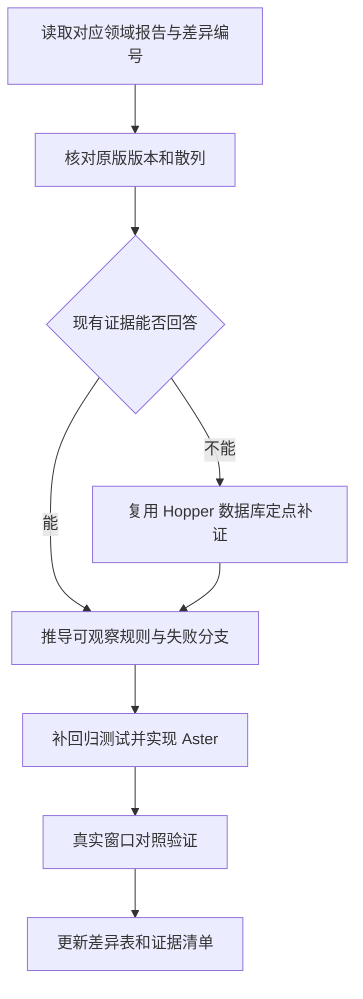

# Otty 1.6.2：Hopper / REA 续查手册

## 目标身份与文件位置

这是 2026-10-25 自动补全及 Pane 顶部菜单重建使用的原版快照，分析地址均为未重定位的 arm64 Mach-O 虚拟地址。后续 Otty 更新后必须重新核对散列，不能沿用这些地址推断新版。

| 文件 | SHA-256 | 保存方式 |
| --- | --- | --- |
| 原版 `/Applications/Otty.app/Contents/MacOS/Otty` | `0fa1027714a601402cc7df42bf05d5c9fab6434f21e01701e7ce8c4bd8d0942e` | 原始安装位置；未复制到 Git |
| `local/rea/otty-1.6.2-0fa10277.hop` | `155cb11ed6e0d4729688cf637e44fbf5bf0d608c469220e5a7dd4a44571d3603` | Hopper 已分析数据库，289,025,935 bytes，本机保留 |
| `local/rea/otty-arm64.macho` | `45a8faffb4ec0f8c03b98e8d4e98091b819faa7d5ae4c43986f030c5cc07810e` | 对应输入切片，41,329,552 bytes，本机保留 |
| `evidence.tar.gz` | 见 [manifest.json](manifest.json) | 189 个关键输出，约 3.7 MB，随 Git 保存 |

本机主工作区的原始文件位于：

```text
/Users/mike/source/project/openfabrica/aster/docs/developer/otty-analysis/1.6.2-0fa10277/local/rea/
```

`local/rea/` 保存全部原始调查输出，`local/pane-header-ui/` 保存 Pane 菜单截图、交互记录和历次产物信息。它们独立于已删除的任务 worktree；[local-manifest.json](local-manifest.json) 记录 315 个原始文件的大小和散列。本轮合并验证日志另存 `local/verification/`。`local/` 被本目录 `.gitignore` 排除，不能把 Git 克隆等同于已取得 Hopper 原库。

## 先看哪些报告

| 问题 | 行为与剩余差异 | 可直接检索的导出文件 |
| --- | --- | --- |
| 设置、建议、学习、清除及整体数据流 | [自动补全恢复报告](../../otty-autocomplete-recovery.md)、[Aster 自动补全领域](../../autocomplete.md) | `ghost-policy.json`、`engine.json`、`history.json`、`config.json`、`next.json` |
| 排序、frecency、敏感参数、失败清理 | [原生补全证据](../../otty-native-findings.md) | `native-findings-provenance.json`、`history-*.s`、`engine-*.s` |
| Tab 接受、未选候选、ghost 与 Shell 回退 | [Tab 宿主路径](../../otty-tab-findings.md) | `remaining-keybody.json`、`tab-keybody.txt`、`fig-rules-tab-*.s` |
| Fig 实际消费字段、解析及候选 | [Fig 证据](../../otty-fig-findings.md)、[静态补全规则](../../fig-completion.md) | `remaining-fig-parser.json`、`remaining-fig-deserialize.json`、`remaining-fig-fields.json`、`fig-rules-*.s` |
| Git/npm/Make/Compose/Cargo/SSH 等固定动态源 | [动态补全证据](../../otty-dynamic-findings.md) | `remaining-final-evidence-bundle.json`、`remaining-git-parsers.json`、`dynamic-native-command-table.json`、`dynamic-*.s` |
| Pane 顶部菜单、命名、权限、Git、防休眠 | [原版 Pane 证据](../../otty-pane-header-findings.md)、[Aster Pane 规则与差异](../../pane-header.md) | `pane-header-provenance.json`、`pane-header-panel.s`、`pane-header-rename.s`、`pane-header-title-model.s`、`pane-header-*.s` |

证据包内使用原始文件名。历史报告、provenance 和重现 argv 中的 `.build/rea/<文件>` 是调查时路径；现在应解析为本目录的 `local/rea/<文件>`，或解压目录下的同名文件。原始内容没有为改路径而重写，SHA、伪代码行号及 Evidence ID 因此保持可核对。

## 校验和离线查看

在仓库根目录运行：

```sh
python3 docs/developer/otty-analysis/1.6.2-0fa10277/verify.py
python3 docs/developer/otty-analysis/1.6.2-0fa10277/verify.py --local
```

第一条校验 Git 中的压缩包和其中每个文件；第二条额外校验本机完整原始归档、Hopper 库及输入切片。没有本机 `local/` 时，第二条明确失败，不把缺失当作验证通过。

如需文本检索，解压到自选空目录后使用 `rg`。例如：

```sh
mkdir -p .build/otty-evidence
tar -xzf docs/developer/otty-analysis/1.6.2-0fa10277/evidence.tar.gz -C .build/otty-evidence
rg '100a43310|100a405f8|101434764' .build/otty-evidence
```

这三个地址分别用于 ghost policy、补全 C ABI 和候选引擎；具体调用关系与结论以对应报告和原始指令为准。

## 重开 Hopper 与继续使用 REA

1. 先运行上述 `--local` 校验。使用 Hopper 打开 `local/rea/otty-1.6.2-0fa10277.hop`，复用已完成分析的数据库；不要再次导入同一个二进制进行全量分析。
2. 如果数据库提示旧输入路径不存在，选择同目录 `otty-arm64.macho`，并再次核对其 SHA。原库内部可能保留旧 worktree 的绝对路径，迁移文件并不自动改写 Hopper 内部路径。
3. 使用当前 REA 实际公布的工具 schema。历史成功 driver 使用 `open_binary` 的 `path` 指向该 `.hop`、`provider_id` 为 `hopper`；未来工具版本仍应以实际参数为准。先检查已有会话和目标身份，避免重复开库。
4. 以当前待补的一个行为分支为范围，优先复用 Evidence 与本文索引，再进行定点反编译或有界指令核对。每项结论记录触发、输入、处理、输出、副作用、失败、证据类型及对应回归测试。
5. 结束时按当前工具协议关闭自己创建的会话。没有收到正常关闭确认时，保留 `cleanup_incomplete` 等原始结果，另行核实进程状态。

原始 driver 脚本也保存在本机归档中，但含当时的 npx 缓存路径，不应直接当作当前可运行入口。首次桥接曾在 `server.accept()` 等待中被中断，随后出现 `SystemError` / `KeyboardInterrupt`；Pane 调查的独立桥接也曾 readiness timeout。它们不是成功反编译证据，也不能据此认定保存的 Hopper 数据库损坏。

## 下次对齐从哪里开始



自动补全优先按恢复报告的 D01–D16、动态报告 ND01–ND08 逐项核查；Pane 菜单按该领域的“仍可见差异及未验证边界”继续。Tab 截图中的浅色 `kout` 曾被误报为已插入，后来已由用户纠正；继续调查时必须用实际输入字节或后续编辑验证，不能重新将预览当作接受。

静态伪代码并非原始源码；LLVM 核对不是额外 REA Evidence；有分支代码也不等于该分支在当前规格快照中可达。历史产物路径、PID、时间和 SHA 只证明当时快照，不能当成当前应用的运行信息。

## 合并前验证记录

2026-10-25：308 项定向 Swift 测试通过（覆盖补全、Fig、动态源、Pane、权限、Git 及标题/Dock 关联行为），测试封装的 8 项 Python 检查、Fig Node 4 项与 Python 导出 2 项通过；五语原生及网页本地化检查通过。未运行全量测试。主工作区合并后还会重新构建与验证，最终产物以主工作区 `dist/Aster.app` 为准。
