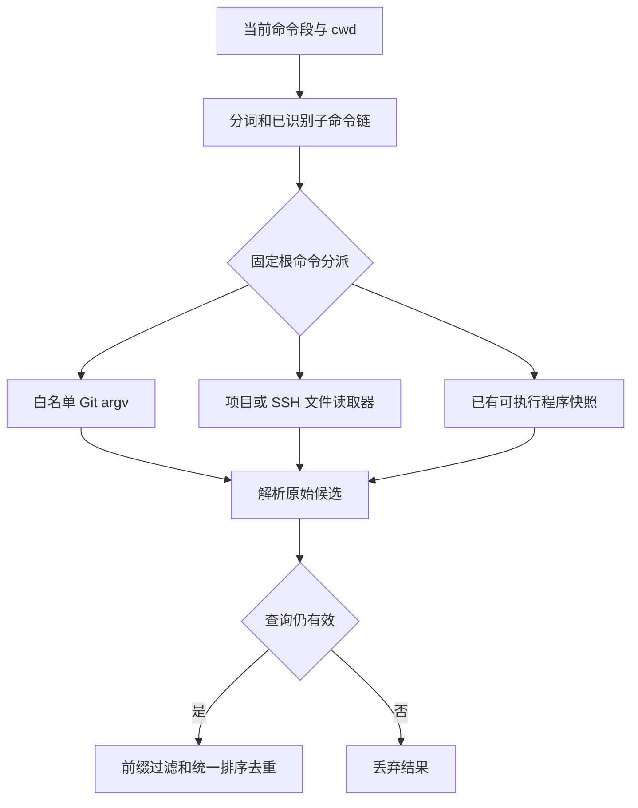

# Otty 动态补全的恢复与实现

> 归档说明：Hopper 原库、关键反编译输出、SHA-256 清单和重开步骤已整理到 [Otty 1.6.2 分析存档](otty-analysis/1.6.2-0fa10277/README.md)。本文中的 `.build/rea/`、任务 worktree 路径与 PID 为历史记录；续查时使用存档中的同名文件，不能当成当前运行状态。

本页对应 Otty 1.6.2 的原生动态候选路径。Aster 已按恢复的规则实现固定命令分派器、文件读取器和 Git 进程执行器。结论来自 REA/Hopper 与同一二进制的有界 arm64 指令；隔离目录测试验证 Aster 行为，不代表已完成 Otty UI 的逐项运行差分。

## 证据与范围

目标 `/Applications/Otty.app/Contents/MacOS/Otty` 的 SHA-256 为 `0fa1027714a601402cc7df42bf05d5c9fab6434f21e01701e7ce8c4bd8d0942e`；arm64 slice 为 `45a8faffb4ec0f8c03b98e8d4e98091b819faa7d5ae4c43986f030c5cc07810e`。

| 证据 | 位置与用途 |
| --- | --- |
| REA `ev_b6da018c3e8552926e51c1a4bf1b034a7f9f6a8b2f8987e9120431a1caaf8cf4` | `.build/rea/remaining-evidence-bundle.json`：导出的分派器及辅助函数；初次 MCP 响应超过 10 MiB，不能将传输错误当作分析失败 |
| REA `ev_dcf0ad08af59012d9c42eaff145736e551bc7dd5e07f0b779a0689582fc1af4b` | `.build/rea/remaining-git-parsers.json`：Git 输出解析器 |
| 有界 LLVM 指令 | `.build/rea/dynamic-native-dispatcher.s`、`dynamic-process-body.s`、`dynamic-process-exec.s`、`dynamic-*-mapper.s`；不是额外 REA Evidence |
| 边界与常量 | `.build/rea/dynamic-static-index.json`、`dynamic-native-command-table.json`：Mach-O 函数边界、固定 argv、解析器表 |
| SSH/Cargo 补充 | `.build/rea/fig-rules-dynamic-notes.md`、`fig-rules-provenance.json`：逐项规则、地址、工具与输出 hash |

Hopper 将部分入口解析到前一函数，伪代码还含异常路径的巨大展开；本页以 `LC_FUNCTION_STARTS` 确认的 `0x10140ffc8–0x101417a84` 分派器边界和有界指令核对这些位置，不凭最近的符号名称判断函数身份。

原生 Rust `SpecArg` decoder 只消费 `name/description/template/suggestions`，未知的 `generators` 字段被跳过。因此本轮不执行任意 Fig `script`，也不按 Fig 的 `cache/trigger/splitOn/timeout` 理论语义填补原生分派器。详见 [Fig 数据消费规则](otty-fig-findings.md)。这不代表另一条 Swift 备用路径具有同样行为。

## 入口、时间和候选协议

入口 `generators::completions_for` 为 `0x10140e9d0`，引擎在无规格和有规格路径均可调用。内层按根命令精确分派：`git`；`npm/npx/pnpm/yarn/bun/bunx`；`make/gmake`；`docker/docker-compose`；`cargo`；`ssh/scp/sftp`；`which/whence/type/command`；`jump`。未匹配分支返回空。

上下文规则：

- 已识别子命令链来自规格解析；别名/选项的上下文规则见 Fig 文档。
- 参数位置 `arg_position` (`0x10140ebbc`) 从子命令链之后计数，排除当前未完成 token，也排除任何以 `-` 开头的已完成 token。它没有通用的选项值识别。
- `has_flag` (`0x10140ed28`) 比较完整 token，不拆 `--name=value`、短选项组合。
- `matches` (`0x10140ec4c`) 对输入与候选分别 Unicode 小写，再做前缀匹配；空前缀匹配全部。
- 总预算为单调时间 `now + 3s` (`0x1014347a8–7b8`)；`has_time` 严格比较截止时间。它与历史存储的整秒 Unix 时间无关。
- 固定 Git 命令在 cwd 内执行，不经过 Shell。每条超时为 2 秒；仅成功退出的 stdout 经首尾空白修剪后进入解析，启动、读取、退出或超时失败不生成该来源候选。原版子进程调用 `setsid`。

Aster 的 `CompletionDynamicItem` 只承载原始 `name/displayText/description/kind/clearLeader`；这些已实现来源的 `clearLeader` 为 false。Core 负责前缀匹配、转义、插入、历史排序和最终去重。应用层 `AutocompleteNativeDynamicProvider.candidates` 在可取消后台任务中读取磁盘/启动固定 argv；调用者用输入、目录与生命周期检查拦截迟到结果。

## Git

固定 argv 表在 `0x10226a800`，argc 表在 `0x101ce3148`，解析器表在 `0x10226a7c0`，调用 `process::exec` 的指令点为 `0x10141394c`。进程主体 `0x101446860` 与入口 `0x101447674` 已用于确认秒单位和失败路径。

| 来源 | 固定 argv |
| --- | --- |
| 本地分支 | `git branch --no-color --sort=-committerdate` |
| 远端分支 | `git branch --no-color --remotes --sort=-committerdate` |
| remotes | `git remote` |
| tags | `git tag --list --sort=-version:refname` |
| stashes | `git stash list` |
| 工作区状态 | `git --no-optional-locks status --short` |
| 暂存文件 | `git --no-optional-locks diff --cached --name-only` |
| 未暂存文件 | `git --no-optional-locks diff --name-only` |

| 子命令与条件 | 来源顺序 |
| --- | --- |
| `checkout/switch` | 本地分支、远端分支、tags |
| `merge/rebase/cherry-pick` | 本地分支 |
| `branch` 含精确 `-d/-D/--delete` | 本地分支 |
| `tag` 含精确 `-d/--delete` | tags |
| `log/show` | 本地分支、tags |
| `reset` | 暂存文件、本地分支 |
| `add` | 工作区状态 |
| `restore` 含精确 `--staged/-S` | 暂存文件；否则未暂存文件 |
| `diff` 含精确 `--staged/--cached` | 暂存文件；否则未暂存文件、本地分支 |
| `push/pull/fetch` | 参数位置 0 为 remotes，1 为本地分支，之后为空 |
| `stash apply/drop/show/pop` | stashes；其他 stash 子命令为空 |

分支行去首尾空白和当前分支的 `* `，跳过 `(` 开头的 detached 行；远端分支跳过含 ` -> ` 的符号引用，候选去掉首个 `/` 前的 remote，description 保留完整远端名。分支、remote、tag 分别使用 `branch/remote/tag` 描述。stash 按首个冒号分开候选名与描述。

状态解析只取第二个状态字符不为空格的行，因此纯暂存项不进入 `git add` 的这个来源。去掉前 3 个字符后，重命名取 ` -> ` 后的目标；成对外层双引号被移除。描述为 `?? → untracked`、` M → modified`、` D → deleted`、`MM → modified (partially staged)`、`AM → added, then modified`，其他状态保留 trim 后的状态码。diff 文件描述分别是 `staged/modified`。这些文件候选 kind 为 file，其他 Git 候选为 argument；保留命令返回顺序后再交统一引擎处理。

## 项目文件来源

| 来源 | 已实现的触发、读取与输出 |
| --- | --- |
| package scripts | `npm/pnpm/bun run` 或 `run-script`；`yarn run`，以及 yarn 尚无子命令且参数位置为 0。从 cwd 向上最多检查 10 个目录，首个存在的 package.json 即停止，读取/JSON 失败不退回更高父目录。只收集 scripts 的字符串值，键按 UTF-8 字节升序，值完整保留为 description |
| node_modules/.bin | `npx/bunx`；已识别子命令 `exec/dlx`，以及非 yarn 的 `x`。只枚举 cwd/node_modules/.bin；前 200 个成功条目先消耗名额，再过滤非 UTF-8/隐藏名，最后 UTF-8 字节升序。不要求文件可执行，也不检查是否普通文件。description 为 bin |
| Make | `make/gmake` 读取 cwd 中首个成功读取的 GNUmakefile、makefile、Makefile。忽略空行、注释、缩进配方和普通点目标；普通目标取首个冒号之前并拒绝变量赋值、`%`、`$`；`.PHONY` 前缀取冒号之后，允许 `%/$`。按 ASCII 空格拆目标、去首尾空白，首次出现去重，描述 target。不展开 include/变量 |
| Compose | 分派器识别 `docker compose` 或 `docker-compose`，但白名单操作必须出现在**规格已识别的子命令链**中：`up/start/restart/pause/unpause/rm/build/ps/stop/create/logs/exec/pull/push/port/run/top/kill`。当前原版数据库下 `docker compose` 的此路径不可达，见下文。按 compose.yml、compose.yaml、docker-compose.yml、docker-compose.yaml 读首个成功文件；只扫描第一个顶层 services 节，首个子行缩进确定服务层级。服务行必须以冒号结束，去冒号后不得含 ASCII 空格；不展开内联 map、alias、环境变量或 include。描述 service |
| which 等 | `which/whence/type/command` 的参数位置为 0 时，用现有可执行程序快照按 UTF-8 字节升序产生 argument 候选；之后为空。没有额外 description |

项目脚本仅显示名称和脚本文本；不会运行脚本。上述来源的候选 kind 均为 argument。

Compose 的上下文证据链：`parse_context` 只有命中 child.name/aliases 后才复制实际 token 到子命令链（`0x10143afb8–affc`），链的 pointer/count 输出到结果 `+0x20/+0x28`（`0x10143b05c–b074`）。引擎把这对值原样装入 `GeneratorContext +0x10/+0x18`（`0x1014374d0–4d4`、`0x101437518–51c`），raw token 数组另在 `+0x20/+0x28`。分派器的 docker 路径读取子命令链首项，必须等于 `compose`，随后去掉该项；剩余为空就返回空，不再从 raw tokens 寻找操作（`0x1014119f4–1a44 → 0x101411164`）。docker-compose 直接检查该链首项（`0x10141049c–4b0`）。白名单匹配成功才到文件读取入口 `0x101412b70`。依据：已保存 REA `ev_0e28c28363924fca79310f58ffc3c85116195628abcbde54df775a4381737610`、`ev_b6da018c3e8552926e51c1a4bf1b034a7f9f6a8b2f8987e9120431a1caaf8cf4`，以及 `fig-rules-parser.s`、`engine-candidates.s`、`fig-rules-dispatch-annotated.s` 的有界 LLVM 指令。

当前打包快照存在确定的可达限制：只读核对 `.build/rea/fig-rules-client.db` 与 `/Applications/Otty.app/Contents/Resources/completions-client.db.lzma` 的内存解压结果逐字节相同，解压后 SHA-256 为 `bf24a178e384484e28ceb31e68e627b5d58e0d2725d1092e8c6d9c8e56d5e615`。其中 docker 的 compose 节点仅有 name/description，没有 subcommands；docker-compose 根有 25 个 subcommands，包含 up。因此 `docker compose up rea-` 的已识别链仅为 `[compose]`，不产生原生 Compose 服务候选；`docker-compose up rea-` 的链为 `[up]`，可进入读取器。这与静态规格不消费 Fig `loadSpec` 链接有关，不应归类为尚未实现任意 Fig generator，也不应增加 raw-token fallback 来改变原版行为。若将来的数据库展开了 compose 子命令，可达性会随规格变化。

主任务的 Aster 真实窗口验证在同一项目夹下观察到：`docker-compose up rea-` 显示 `rea-api` / `rea-worker`，`docker compose up rea-` 没有服务候选。此处原版结论来自其打包规格与原生控制流，未另行声称完成原版窗口交互验证。

## Cargo

只根据上一 token 的精确值触发：`--bin`、`--features/-F`、`--bench`、`--package/-p`，另有 `--example`。等号形式不等价。manifest 路径 `0x101414134–26c` 向上检查最多 10 层；首个存在 Cargo.toml 后停止，即使随后读取失败。

逐行解析器 `0x101414d20–101415968` 按 trim 后的节名和第一个 `=` 拆字段；不是通用 TOML。空行与首 `#` 行跳过，只去掉值成对首尾的 ASCII 单/双引号，不解释转义、行尾注释或续行。

- `[bin]/[[bin]] name` 依声明顺序累积；列表为空才回退 `[package] name`。
- `[bench]/[[bench]] name` 累积；`[features]` 保留全部键原文，但排除精确 `default`。
- `[workspace] members` 要求值以 `[` 开头，同一行取首个 `]` 前的部分按逗号拆，trim/去外层引号，保留非空原文。不展开 glob、不取 basename、不读取成员 manifest。
- 上述类别保持清单顺序，描述分别是 bin/bench/feature/package。
- examples 直接来自 **cwd/examples**，与 manifest 根位置无关；前 200 个成功目录条目消耗预算后过滤非 UTF-8/隐藏名，只移除 `.rs` 后缀，目录和其他扩展名也保留；名称按 UTF-8 字节稳定升序，描述 example。

映射器与 caller 的排序证据分开核对：普通 manifest 类别不局部排序；examples 在 `0x101414a1c → 0x101416990` 排序，2–20 项与 21 项以上的比较器均为 text 字节与长度。

## SSH、SCP、SFTP

共享 host 来源，仅适用于首个 host 位置。已完成 token 从下标 1 遍历，遇空 token 或非 `-` 开头 token 就返回空。精确取值选项 `-b -c -D -E -e -F -I -i -J -L -l -m -O -o -p -Q -R -S -W -w` 跳过自己与下一 token，其他 dash token 只跳过自身；不拆短选项组合。因此 `ssh -p ` 仍会进入 host 来源，而 `scp local ` 不会。

当前 token 按第一个 `@` 切分，保留用户前缀，主机部分前缀匹配。按 config、known host、recent 的顺序去重，description 精确为 `ssh config/known host/recent`，kind 为 argument。

config 使用 Loader 路径 `0x10147894c → 0x10147ac10`：

- 原版应用管理的 config_dir/ssh_config 在 ~/.ssh/config 之前；文件 canonicalize 后 visited 去重，读取失败跳过。
- 根 depth=0，depth>=3 不再读取，所以最多进入两层 Include。相对 Include 永远相对 home/.ssh；`~`、`~/` 和绝对路径按字面展开，再 glob 遍历，不相对当前被包含文件的目录。
- 行 trim 后跳空/#；键到首个空白或 `=`，键 ASCII 小写；余下部分可去一个首 `=`。值只有双引号有分组作用，单引号、反斜杠、行内 `#` 均为字面字符，不拒绝未闭双引号。
- 只输出具体 Host alias，不输出 HostName；名称含 `!/*/?` 时过滤。`Host alpha # note` 可输出 alpha、#、note；`Host "alpha beta"` 是一个名称。

known_hosts parser `0x101478080` 对行 trim 后跳空/#/哈希行；首字段若是 `@` marker，则取第二字段；host 字段按逗号拆。`[host]:port` 取 `[]` 内，缺右括号时保留左括号后的全部内容。空值及含 `!/*/?` 的名称跳过；不验证 key type 或 key 内容，按首次出现去重。

Aster 提供 `additionalSSHConfigPaths/recentSSHHosts` 注入点，当前生产默认仅读取用户 ~/.ssh/config 与 ~/.ssh/known_hosts；不会读取 Otty 的应用数据。未接入部分见下表。

## 实现、测试与剩余差异

应用层实现分为 `AutocompleteNativeDynamicProvider`、`AutocompleteDynamicProcess` 以及 Git/Project/Cargo/SSH 四个读取器；Core 只有纯值 `CompletionDynamicItem`，不依赖进程、网络或 AppKit。旧 `AutocompleteDynamicCache` 为兼容代码仍存在，新原生动态查询不通过它，因而不继承旧 5/60 秒 TTL。本次已检查的原生路径没有证据支持采用该 TTL。

`Tests/AsterTests/AutocompleteNativeDynamicTests.swift` 由已恢复规则派生 14 项测试：Git 路由/原始 argv/解析；script 只读和最近 manifest 错误停止；node bin；Make；Compose；which 与取消；进程字面参数/非零/超时/输出边界；Cargo 的顺序、fallback、members 和 examples；SSH 槽位、known_hosts、Include 深度与顺序。主线程另有动态结果生命周期测试。具体运行结果以主任务最终回归日志为准，不以本页的测试存在替代通过证明。

| 编号 | 当前仍可观察的差异或未验证边界 |
| --- | --- |
| ND01 | `jump` 尚未实现。原版从 trait 提供的目录历史取最多 12 项并生成目录候选；历史存储来源未恢复，不能用 cwd 枚举或 learnedFolder 猜测代替 |
| ND02 | Aster 当前未连接应用管理的 SSH config 和 recent 数据，因而这些候选可能缺失。原版 recent 的 SQL 条件、排序与上限尚未恢复；也未读取原版用户数据库 |
| ND03 | SSH Include 使用 Darwin glob。原版 glob 的完整模式语法、展开排序，以及非 UTF-8 Include 路径处理尚未逐项恢复，不能宣称相同 |
| ND04 | Aster 使用 1 MiB 文件/stdout 上限，只读取普通文件；原版相同上限与文件类型限制未证实。大文件、特殊文件与输出超限可能产生不同候选；Aster 超限返回空来源 |
| ND05 | Aster 将每条 Git 剩余时间裁到总 3 秒以内。原版在来源之间检查总预算，每条仍可取得完整 2 秒，可能越过总预算。Aster 文件系统调用仍可能被 OS 阻塞，取消是检查点式；不能保证所有 I/O 都在 3 秒墙钟内结束 |
| ND06 | Aster 创建独立进程组，原版调用 setsid。终端会话关系、PATH 查找的异常回退、stdout 非 UTF-8 替换和极端管道/进程退出竞态未完成运行差分；正常成功/非零/超时已按恢复规则实现 |
| ND07 | 原生 `otty` 包装命令的跳过选项与 token 重定位尚未移植；provider 支持简单 root alias 映射，但生产查询当前未传入 aliases。复杂 Shell 别名、环境赋值、组合命令和 token 边界仍受 Aster tokenizer/协议限制 |
| ND08 | Aster 异步先显示静态候选再合并动态值，并按 Pane/输入代次丢弃迟到结果；这套调度未证明与 Otty UI 时序相同。真实 Otty Tab、跨 Pane、远端、超大目录、权限故障等运行差分仍未完成。Aster 远端查询明确不执行本机动态来源 |

这些差异应与 [补全恢复总报告](otty-autocomplete-recovery.md) 的存储、更新、路径及界面差异一起阅读。未知语义保持未知；不能把未执行的 Fig 任意脚本列为这条 Rust 原生路径的缺失功能。
