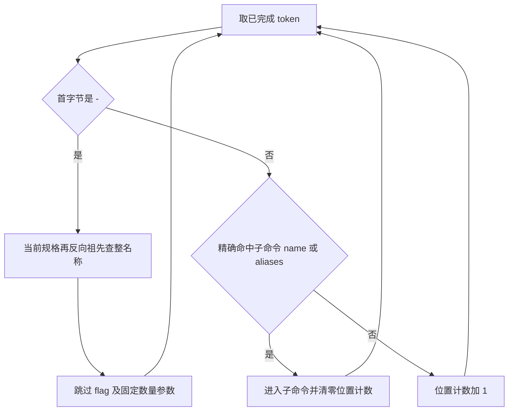

# Otty 1.6.2 的 Fig 数据消费规则

> 归档说明：Hopper 原库、关键反编译输出、SHA-256 清单和重开步骤已整理到 [Otty 1.6.2 分析存档](otty-analysis/1.6.2-0fa10277/README.md)。本文中的 `.build/rea/`、任务 worktree 路径与 PID 为历史记录；续查时使用存档中的同名文件，不能当成当前运行状态。

本文记录已发布 Otty 的 Rust 补全路径实际消费的 Fig 数据，供 Aster 实现和回归测试使用。它不是 Fig 规范摘要，也不把 Swift 模型中存在的字段视为 Rust 引擎已支持的功能。伪代码是 REA/Hopper 产物，不是原始源码；本次结论来自静态调用、字段分类器和 arm64 指令，尚未逐条在 Otty UI 中运行自定义规格验证。

## 目标与证据

目标 `/Applications/Otty.app/Contents/MacOS/Otty`，SHA-256 `0fa1027714a601402cc7df42bf05d5c9fab6434f21e01701e7ce8c4bd8d0942e`。沿 `Engine.complete → lookup_spec → Rust CompletionSpec deserialize → parse_context → candidate generation` 调查，复用 `.build/rea/otty-1.6.2-0fa10277.hop`。

| 简称 | REA Evidence ID | 本地结果 |
| --- | --- | --- |
| P | `ev_0e28c28363924fca79310f58ffc3c85116195628abcbde54df775a4381737610` | `.build/rea/remaining-fig-parser.json`：查规格、解析上下文、选项候选、路径模板、隐藏判定 |
| D | `ev_f91566a79569652dfbd08300fac92ed30922cdd3b7d3b2d67e80e2b6bc446c15` | `.build/rea/remaining-fig-deserialize.json`：CompletionSpec JSON decoder |
| F | `ev_8ce5139646efbd204c0bad3cd84deb009db4b00c92ac0a2ce6408d9e72c848d8` | `.build/rea/remaining-fig-fields.json`：CompletionSpec/SpecArg 字段分类器、SpecArg 与 SpecOption decoder |
| N | `ev_96a649374255ac759491fbc8ff9ee762258981712dbd2a0f6ba0a7d996c3444f` | `.build/rea/next.json`：`0x101434764` 候选引擎 |

同一二进制的有界 LLVM 反汇编用于核对 Hopper 丢失的字符串立即数、比较方向及循环边界；这些文件不是额外的 REA Evidence。文件哈希、工具版本和范围在 `.build/rea/fig-rules-provenance.json`。关键输出已作为压缩证据包随 Git 保存，原始 Hopper 数据库和完整输出保留在主工作区文档的 `local/` 归档中。

## 实际模型与忽略字段

`lookup_spec` 的 JSON 路径调用 `0x10142fcd4`。下面是穷举字段分类器及其未知分支得到的允许集合，不是通过搜索不到字符串推断的集合。

| Rust 模型 | 实际读取的 JSON key | 证据位置 |
| --- | --- | --- |
| CompletionSpec | `name`、`description`、`subcommands`、`options`、`args`、`aliases` | D `0x10142fcd4`；F `0x10144ae4c`；未知 key 为分类 6，decoder `0x1014300d0–104` 跳过其 JSON 值 |
| SpecOption | `names`（复数）、`description`、`args` | F `0x10146fab4`，伪码行 750–963；LLVM `0x10146fd50–fe80`，其余 key 调用 `0x101403114` 跳过 |
| SpecArg | `name`、`description`、`template`、`suggestions` | F `0x10142eef4` / `0x10144abc4`；未知 key 为分类 4 |
| StringOrSuggestion 对象 | `name`、`description` | SpecArg decoder 调用 `0x101472488`；LLVM `0x101472644–28d4`，未知 key 推进到下一字段 |

由此，当前 Rust 路径忽略以下字段的语义：

- 命令级 `parserDirectives`（包括选项顺序、POSIX flag、分隔符规则）、`hidden`、`priority`。
- 选项级 `isDangerous`、`exclusiveOn`、`dependsOn`、`priority`、`separator`、`isPersistent`、`isRepeatable`、`hidden`。
- 参数级 `isOptional`、`isVariadic`、`isCommand`、`filterStrategy`、`generators`。
- 静态 suggestion 对象的 `priority`、`displayName`、`insertValue`、`isDangerous` 等非上述两个字段。

“忽略 generators 字段”不等于 Otty 没有动态补全。原版另有按命令分派的原生 generator；其规则见 [动态补全调查](otty-dynamic-findings.md)。二进制中也有独立 Swift Fig 模型，本页不对其备用路径作等价声明。

## 上下文解析

P `parse_context` 的实际入口为 `0x10143ac80`。输入是根规格、token 数组及是否处于词边界；从 token 下标 1 开始，词边界时处理全部 token，否则排除正在输入的最后一个 token。

选项名匹配按完整 UTF-8 字节、区分大小写。优先当前规格，再从最近父级向根查找；一个选项的多个 `names` 逐一尝试。无匹配的 `-` 开头 token 只跳过自身，不增加位置计数。原生解析器没有拆分 `--name=value`、短选项 cluster `-abc`，也没有把裸 `--` 作为后续全为位置参数的标志；完整字面值若就在 `names` 中则仍可匹配。

命中选项后，无 `args` 时下标加 1；单个 SpecArg 时加 2；数组时加 `1 + args.count`。不检查值是否以 `-` 开头，也不读取 optional/variadic。下标可跳过尚未提供的值，最终输出的 startIndex 限制到 token 数量。依据：`0x10143ad74–aef0`，P 伪码行 80–190、350–379。

非选项 token 按 child.name 或 child.aliases 做区分大小写的完整匹配。成功后保存实际输入的别名/名称到子命令链，进入 child，位置计数归零。失败只把位置计数加 1；后续 token 仍可以命中 child，不要求此前没有位置参数。依据：`0x10143aef4–b04c`，P 伪码行 516–749。

祖先数组初始包含根，进入首个子命令时又压入旧的根；因此原始遍历内部可能重复根。后续统一按候选文本去重。对外需要保留的规则是当前规格优先、近父级优先，以及完整候选合并后的去重；不应把内部重复当成额外可见候选。

## 静态候选生成

当前前缀非空且首字节是 `-` 时，直接生成当前规格和祖先选项候选；不进入本次普通静态子命令/参数/模板分支。其后仍可能合并原生动态来源。普通前缀包含空前缀时按以下规则生成：

1. 只有位置计数为 0 时列出当前规格的子命令。
2. 合并当前规格 `args` 的**全部** SpecArg 的静态 suggestions，不按位置计数选单个参数。
3. 合并当前规格和祖先的选项。
4. 合并当前规格全部参数模板启用的路径候选，再进入动态来源和统一排序/去重。

依据：N `0x101434764`，`0x101436514–540` 是 `-` 分支，`0x1014365b0` 使用位置计数门控子命令，`0x101436fa0–101437298` 遍历当前规格的全部参数，`0x101437330–34c` 收集选项。这个静态路径未选择“上一选项的 args”来产生值候选；选项 args 在上述解析阶段影响跳过数量，原生动态来源可能另外读取 token。不能把通用 Fig 的 option-value 规则套在此处。

子命令候选仅使用 `child.name`，不会将每个 alias 输出成候选。`aliases` 中只要有区分大小写的字面字符串 `hidden`，整条 child 就不生成候选；JSON `hidden: true` 不参与这个判定。已输入隐藏 child 的名称或别名仍可进入它，因为解析下钻不调用隐藏判定。依据：P `is_hidden` `0x10142ee7c`；候选迭代器 `0x10140deec` 在 `0x10140df50–dfa8` 检查 marker，随后 `0x10140dfac–e028` 只复制 name；解析的 `0x10143af30–afb8` 不检查隐藏。

选项候选顺序为当前规格、祖先数组逆序；每个选项按 `names` 数组顺序输出。候选生成不接收已使用 flag 集合，不因已使用、互斥、缺少依赖或非 repeatable 而去掉选项。依据：外层 `0x101432638` 的 `0x101432694` 与 `0x1014326a4–6c4`；P 内层 `0x101432730` 只读取 names/description。

子命令、选项和静态参数 suggestion 的前缀匹配都对名称与前缀作 Rust Unicode `to_lowercase`，再按 UTF-8 前缀比较。识别完整已完成 token 则区分大小写，二者不可混用。候选文本、显示文本和 description 保留原始字符串；不按 shell 安全字符白名单删掉空格、尖括号或标点，不按 1024 字符截 description。静态 suggestion 循环遍历完整向量，没有 2000 项截断。该结论限于这些路径，不能解释为整个加载和内存系统没有资源限制。

静态构造将 clear_leader 设为 false；最终排序不是 Fig priority，而是已恢复的历史分数、候选 kind rank 和原始下标。详见 [原生候选排序](otty-native-findings.md#候选查询排序及合并)。原始复制和遍历证据：`0x101437014–298`、`0x10143284c–8c8`、`0x10140e024–e0a4`。

## 文件模板

P `CompletionSpec.filepath_templates` `0x10142ecb8` 遍历当前规格全部 SpecArg；每个 `template` 可为单个字符串或字符串数组。字面值区分大小写：`folders` 启用目录，`filepaths` 同时启用文件和目录；其他值不启用。这些开关跨参数取 OR，不根据当前参数位置选择，不读取 option.args 的模板。候选引擎的 `0x101437928–7a00` 内联了相同规则。

有 cwd 且未超预算时按模板取路径；即使模板未启用全部类型，当前前缀含 `/` 仍可再走文件与目录的通用路径补全。这里只证明 `0x10143774c–7a04` 的 `/` 触发，不把 `~` 等同于这一条件。路径枚举、点文件、shell 转义及时间预算的细节由动态/路径证据另行约束。

## 可派生的回归样例

使用隔离规格 `tool`：根选项 `--root`、`--take`（单参数，suggestions 为 `VALUE`）、`--pair`（两个参数）；根 args 的两个 suggestion 集合分别是 `FIRST`、`SECOND`。子命令 `run` 的 aliases 为 `r`，自身有 `--local` 与 suggestion `CHILD`；另有 `ghost` 的 aliases 包含 `hidden`，以及 JSON `hidden: true` 的 `visible`。下面只断言静态来源，排除历史、真实文件和动态 generator 的额外结果。

| 输入或改动 | 可观察断言 |
| --- | --- |
| `tool ` | 有 `run`、`visible`、`FIRST`、`SECOND` 和根选项；没有 alias `r`，没有 `ghost`，没有 `VALUE` |
| `tool one ` | 子命令不再列出；仍有 `FIRST`、`SECOND` 和根选项 |
| `tool one run ` 或 `tool r ` | 进入 run；显示 `CHILD`、自身和根选项，不再使用根 args |
| `tool --take run ` | run 被当作 option 的值跳过，仍在根规格 |
| `tool --pair one run ` | 两个值均被跳过，仍在根规格 |
| `tool --take ` | 静态路径仍取根 args，不能据此要求显示 `VALUE` |
| `tool --take=one run `、`tool -ab run `、`tool -- run ` | 这些完整未知 flag 只跳过自身；后续 run 仍进入子命令 |
| `tool --root --` | 已使用的 `--root` 仍可成为选项候选 |
| `tool R` 与 `tool R ` | 未完成前缀可匹配 `run`；完成后的大写 R 不作为小写 alias r 下钻 |
| `tool ghost ` | 不影响隐藏子命令的显式下钻 |
| 切换 isOptional/isVariadic/isPersistent/isRepeatable 等忽略字段 | 上述解析和静态候选保持相同 |
| 2001 个静态 suggestion，description 长 1025 | 不因 Aster 自设的 2000/1024 阈值丢失 |
| suggestion 为 `Content-Type: application/json`、`branch.<name>.remote` | 保留原始字面字符串及标点 |
| 两个 root args 分别设置 `folders` 与 `filepaths` | 任意位置均得到模板并集；`Folders`、未知模板不启用 |

## 边界

本页没有证明所有输入 JSON 的错误恢复、未知键内的非法 JSON、递归深度、全局数据库容量或超大文件处理完全一致；未知字段“被忽略”仍要求 JSON 值本身可被解析/跳过。也没有用 Swift 备用引擎、理论 Fig 文档或网页模拟结果补足未知行为。动态生成器的 token 解析与这里的静态解析可能不同，应保留各自证据。实现完成后的 UI 触发、Tab 接受和可见差异须由主任务的真实事件验收说明。
