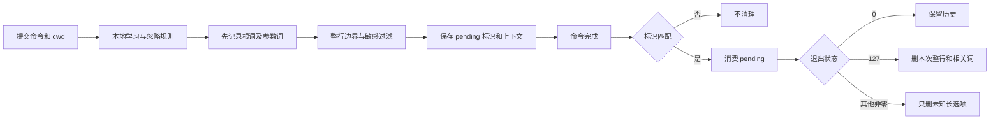

# Otty 1.6.2 原生补全证据

本文是 REA 调查的原生规则记录，供独立实现和回归测试使用。伪代码不是原始源码；静态分支成立不代表宿主 UI 已运行时验收。早期推断以本文最终规则为准。

## 目标与证据

目标 `/Applications/Otty.app/Contents/MacOS/Otty`，SHA-256：`0fa1027714a601402cc7df42bf05d5c9fab6434f21e01701e7ce8c4bd8d0942e`。
Hopper 数据库 `.build/rea/otty-1.6.2-0fa10277.hop`，SHA-256：`155cb11ed6e0d4729688cf637e44fbf5bf0d608c469220e5a7dd4a44571d3603`。

| 简称 | REA Evidence ID | 文件与内容 |
| --- | --- | --- |
| G | `ev_eda6dd6a25abd0bf6178a38923661a1642b17f7979079d5b6782b8b1ffc65be9` | `ghost-policy.json`：配置掩码 |
| E | `ev_86926f0436e9f24aa29f94229d5ece3d927c4bde1d2386fafd28724a8af63a73` | `engine.json`：配置、清理、记录、完成事件、候选合并 |
| H | `ev_cf581ebaa5166e484e69c0b7fccdb51cf5be0f68d77ec90e45bd12bf38d96833` | `history.json`：frecency、失败清理、整行历史、记录 |
| C | `ev_b33ee9dfd268988e487d4a3db37474e9f34ba78f5dda4cf22eab97c691042266` | `config.json`：C ABI 清理、配置更新、补全 |
| N | `ev_96a649374255ac759491fbc8ff9ee762258981712dbd2a0f6ba0a7d996c3444f` | `next.json`：候选引擎、枚举解析器、boost、历史查询、数据库清理 |

以上文件均在任务工作区 `.build/rea/`，是未随源码发布的调查产物。下文伪代码行号为对应 item 的 `pseudocode` 的 1-based 行号；G 使用 `raw_result`。大函数伪代码存在重复块和浮点恢复错误，数值结论以指令佐证为准。

从同一二进制提取 arm64 slice（文件偏移 16384、长度 41329552），未修改指令。使用 `xcrun llvm-objdump --disassemble --arch-name=aarch64 --start-address=… --stop-address=…` 有界反汇编。`.s` 的地址范围、SHA-256、工具版本、重现命令在 `.build/rea/native-findings-provenance.json`；它们是独立指令佐证，不冒充 REA Evidence。

## 配置解析与输出

两个解析器先去掉两端 Unicode 空白，再转小写。地址 `0x101587868`、`0x101588c48`（N），共用 trim helper `0x10094c964`（`config-string-trim.s`）。

| 设置 | 枚举值 | 接受字符串 |
| --- | --- | --- |
| 接受键 | 0 | `tab` |
| 接受键 | 1 | `tab+right-arrow`、`tab+right`、`tab+arrow` |
| 接受键 | 2 | `right-arrow`、`right`、`rightarrow`、`right_arrow` |
| 接受键 | 3 | `ctrl+space`、`ctrl-space`、`ctrlspace` |
| 接受键 | 4 | `disable`、`disabled`、`none`、`off` |
| 面板 | 0 | `disable`、`disabled`、`off`、`none`、`false` |
| 面板 | 1 | `auto`、`true` |
| 面板 | 2 | `escape`、`esc` |
| 面板 | 3 | `f5`、`option-escape`、`option+escape` |

`_otty_autocomplete_ghost_policy`（`0x100a43310`）对 null、空、无效 UTF-8、解析失败使用接受键 0、面板 2 fallback（G 行 14–20、284–288、369–373）。面板 fallback 是 Escape，不应与正常设置 Auto 混淆。

掩码（G 行 1385–1464）：接受键 `0→0x1`、`1→0x3`、`2→0x2`，其余 0；面板 `0→0`、`1→0x40`、`2→0x4`、`3→0x18`，非零面板另加 `0x80`。inline 为真加 `0x100`；inline 为假且面板为 0 加 `0x200`。不能仅靠掩码推断 Ctrl+Space 的宿主事件处理。

C ABI complete（C，`0x100a405f8`）：null engine 返回 null；null、空、无效 UTF-8 的输入返回 JSON `[]`；空或无效 cwd 作为缺失处理。有效请求锁引擎、调用 complete、解锁并序列化；序列化错误回退 `[]`，捕获 panic 的分支返回 null（`abi-complete.s`）。

序列化器 `0x1008e5b18` 确认输出字段 `text`、`display_text`、`description`、`kind`、`body`、`clear_leader`；item `+0x60` 为 clear_leader，`+0x61` 为 kind。kind 表 `0x1022014d0` / `0x101b1dc60`：0 subcommand、1 option、2 argument、3 filepath、4 folder、5 alias、6 fix（`completion-json.s`）。

## 提交、学习与完成事件

E `Engine.record_command`（`0x101433c6c`，行 19–22）先 tokenize、计算 history context。H `CommandHistory.record`（`0x1014414ac`）learning 参数 false 时直接返回；首字节为空格 U+0020 时不学习整条命令。不要把前导空格判断扩大成所有 Unicode 空白（`history-record.s`，`0x1014414d8`、`0x10144158c–598`）。忽略规则把 command 与每个 pattern 分别转小写，再按 Unicode scalar 比较；只识别 `?`（一个 scalar）与 `*`（任意数量），其余字符字面匹配，没有 POSIX `fnmatch` 的字符类或反斜杠转义。空 pattern 只匹配空 command。证据为 H record 行 135、144；`history-record.s` 的 `0x1014415c0`、`0x1014415f4`、`0x101441674–6f0`。

根词独立先写入，context 通常为 `""`；以 `./` 或 `../` 开头且 cwd 非空则为 `"\0cwd:" + cwd`（真实 NUL 前缀）。参数 context 无 spec 时为 root；有 spec 时为 root 加已识别子命令链，以空格连接，startIndex 跳过该链。不是任意前序 token 拼接（`history-context.s`、`history-context-join.s`，`0x101439004`、`0x101432b04`；写根词 `0x101441874–920`）。

整行在词历史之后记录：要求 cwd 非空，输入仅去掉末尾 Unicode 空白后非空，Rust `chars` 数量 ≤2048。超过上限不撤销词学习；计 Unicode scalar，不是 UTF-8 字节或 Swift grapheme 数（H record 行 1308、1482；`0x101442c50–ca0`；trim_end helper `0x10094cba8`）。

### 分数和时效

查询分数为 `storedScore × 0.95 ^ clamp((nowSeconds − lastUsedSeconds) / 3600, 0, 720)`。旧项每次记录先同样衰减再加 1，更新 lastUsed；新项分数 1。词历史的 `context + "\t" + token` 在当前引擎对象内存集合存在时，查询额外加 10；不写入持久分数，只有 SQL 写成功后才加入集合。整行不加 10。未经宿主生命周期验证不能称为“每个终端会话”的加分。

now 和 lastUsed 都是整数 Unix 秒；记录只取 `duration_since(UNIX_EPOCH)` 的整秒，纳秒不参与持久化、衰减和最新时间比较。时间在 epoch 前或 duration 失败时取 0。`history-record.s` 的 `0x101441838–868`，`history-full-lines.s` 的 `0x101440534–564`；row converter 在 `0x10140d8c4–8dc` 先作整数差，再转 double 除以 3600。原始 schema 的 last_used 列是 INTEGER。

佐证：`history-frecency.s` 的 `0x10143ec00–ecac`；词更新 `0x101444098–0e8`、内存集合更新 `0x1014441c4–208`；整行更新 `0x101443a9c–b3c`；整行 row converter `0x10140d7e4`。

### 敏感信息的两层规则

词学习不受整行敏感开关影响；根词先独立写入。后续参数的小写形式精确识别以下 flag：`-p`、`--authorization`、`--passwd`、`--apikey`、`--secret`、`--api-key`、`--token`、`--pass`、`--auth`、`--key`、`--password`、`--secret-key`、`--credential`、`--access-token`、`--private-key`、`--credentials`。

standalone flag 本身保留，紧随一个 token 跳过。`key=value` 的 key 若直接命中这组 flag，或加 `--` 后命中，则整 token 跳过，下一 token 正常处理。不是“敏感命令完全不学习”（`0x101442150–194`、`0x101442568–578`、`0x1014424a0–be4`）。

history 对象 `+0x150` 的开关仅控制整行过滤（`0x101442c9c`）；为真时，任一条件成立即不写整行：

- 上述 standalone flag 后仍有 token；末尾无值 flag 不因这条规则拒绝。
- 非空值的 `key=value`：key 去掉前导 `-` 后转小写，包含 `password`、`passwd`、`secret`、`token`、`apikey`、`api_key`、`api-key`、`credential`、`auth`、`access_key`、`access-key`、`private_key`、`private-key` 任一子串。
- 原始 token 以 `sk-`、`ghp_`、`gho_`、`ghu_`、`ghs_`、`github_pat_`、`glpat-`、`xoxb-`、`xoxp-`、`xoxa-`、`xoxs-`、`AKIA`、`ASIA`、`AIza`、`ya29.` 开头；此处保留大小写。
- 原始 token 以 `-p` 开头、字节长度 >6，且后缀不全为 ASCII 数字。
- token 包含 `://`，其后第一个 `@` 前的部分含 `:` 且不含 `/`。
- 整行转小写后含 `bearer ` 或 `authorization:`。

佐证 `history-record.s` 的 `0x101442c9c–101443868`，13 项子串表 `0x102269520`，常量 `0x101ce1a6a`、`0x101ce1be2`、`0x101ce1be9`。此处只陈述比较指令支持的行为，不代表它能检测所有秘密。

### 失败清理

仅处理存在且标识匹配的 pending，在清理前消费。退出 0 只释放 pending，保留已记录历史；不匹配事件不清理（E `command_finished`，`0x101439418`，行 84–137；H cleanup `0x10143f7c4`，行 35–41）。

127：删 exact `(cwd, trim_end(command))` 整行；对本次 tokenize 的非 `-` 开头 token，删 `(pendingContext, token)`；再删 `("", root)`，以及 root 对应 `argument_paths`。相对根词即便存于 cwd context，额外删除仍使用空 context，这是原生实际分支（`history-cleanup.s`）。

其他非零：仅在 known_flags 非空时，删除长度 >2、以 `--` 开头且未知的长选项。判断 known 时取首个 `=` 前名称，删除用完整原 token。短 `-x`、裸 `--` 和整行保留。删除 exact `(context, argument)`，同时移除内存加分键，不是减分（`history-delete-token.s`，`0x10143e418`）。

known_flags 查 recorded_root 的 spec，收集根及其**整棵子命令树**所有 option names；不限当前链。无 DB/spec 则为空（`known-flags.s` 的 `0x101432fe8–101433000`，`known-flags-collect.s` 的 `0x101432528–634`，递归点 `0x10143260c`）。

## 候选查询、排序及合并

三条路径不能套用统一阈值：

| 路径 | 分数与顺序 | clear_leader |
| --- | --- | --- |
| 根前缀：一个 token 且未处于词边界 | PATH、alias、spec、learned、README 等已有候选调用 `history.boost(context="")`；不追加全局历史 token | boost 不设置 |
| 无 spec 的参数候选 | 历史匹配可查完整文本及去掉尾部 `/` 或 `\` 后文本，取较大分；None 按 0 稳定降序 | 不计 None；0 个有分候选为假，1 个为真，至少 2 个时第一分 ≥ 第二分 ×1.5 |
| 有 spec 的参数候选 | 有历史分优先；分数降序，其次 kind rank，再原始 index | 排序不重写，保留来源值 |

根分支 `engine-candidates.s` 的 `0x101434938`、`0x10143640c–488`；N boost `0x1014411e0` 行 17–52。无 spec 参数阈值 `0x101436d90–e14`、`0x1014380ac–c0`。known-spec 比较器 `0x10146bc54`（`spec-candidate-sort.s`、`spec-candidate-compare.s`）。

known-spec kind rank：subcommand/alias 0，argument 1，option 2，filepath/folder 3，fix 4。静态构造明确初始化 false：subcommand `0x10140e0a4`；option `0x1014328c4–c8`；argument `0x101437274–278`；filepath/folder `0x10140e6e8`。外部 generator 的 CompletionItem 不被此排序重置，不能推断所有 generator 都 false。

有 spec 的参数路径只用历史给已有候选排序，不直接追加该 context 下全部已学 token。`lookup_spec` 非空在 `0x1014348c8–8fc` 进入 parse/spec 分支；唯一 `history_completions` 调用 `0x1014359a0` 位于无 spec 且 HelpProbe 没有候选的 fallback（`0x1014357ac → 0x1014358e4`）。

整行历史按以下顺序处理：相同 cwd、SQL LIKE 前缀匹配，按 last_used 降序取最多 500 行，**包含与输入完全相同的记录**；计算衰减分并稳定按分数降序、last_used 降序排序；求这最多 500 行中的最新时间；截断至 20；判断 clear_leader；最后剔除 exact input。clear_leader 要求截断后的首项文本不等于当前输入，并且“只有一项”，或“第一分 ≥ 第二分 +0.5 且第一 last_used 是截断前的最新时间”。剔除 exact 后不补位、不重算领先；因此 exact 占前 20 时结果最多 19 项，exact 为第一项时剩余首项也不领先。不能把 500 当最终数量，或使用词的 +10 / 1.5 倍规则（H `0x101440430`；`history-full-lines.s` 的排序及 max `0x101440b10–bec`、截断 `0x101440bf0–c38`、阈值 `0x101440c3c–c5c`、exact 比较 `0x101440768–78c`、剔除 `0x101440994–a84`）。

LIKE 的 query helper `0x10143dec4` 依次将反斜杠、`%`、`_` 替换为 `\\`、`\%`、`\_`，再追加 `%`；输入中的三者都按字面匹配。SQL 常量 `0x101ce2386` 使用 `command LIKE ? ESCAPE '\'`。ASCII 字母忽略大小写，非 ASCII 保持字面比较，不能对全文使用 Unicode lowercased。依据为原版链接 `/usr/lib/libsqlite3.dylib`、`open_at` 的初始化 batch 只创建表/索引且没有 PRAGMA，以及在同一系统库 SQLite 3.54.0 的内存连接上实测 `GIT status LIKE git%` 为真、`Ä LIKE ä%` 为假。后者是同库默认行为验证，并未动态检查 Otty 已打开连接的 PRAGMA；原版二进制中也未发现 `case_sensitive_like` 常量或自定义 SQLite function 注册符号。此补充来自现有 Mach-O 的只读 LLVM/常量核对，不新增或冒称 REA Evidence。

`Engine.complete` 先查整行历史并把文本放入去重集合，再取其他候选，移除与历史重复的文本。历史首项领先时全部历史在前；历史首项不领先但其他首项领先时，仅把其他首项移到历史前；其余仍先历史后其他。没有跨来源全局重排（E `0x10143a664`，行 21–24、50–63、94–115、166–176、225–258、379–386）。

## 五类清理

`Engine.clear_data`（E，`0x101432d54`，行 22–208）按 **1、2、4、8、16** 顺序执行请求中的项；失败继续，返回成功位 OR。0 请求返回 0，未知位忽略。顺序常量数组 `0x101be8af0`（`clear-data-entry.s`）。C ABI clear 的 null engine 返回 0（C，`0x100a40350`）。

| 位 | 操作 | 成功判定 |
| --- | --- | --- |
| 1 | `clear_token_history` | 成功或 history DB 缺失 |
| 2 | `DELETE FROM full_command_history` | 成功或 history DB 缺失 |
| 4 | `HelpProbe.clear_all_cached_help` | void 调用返回即加入成功位 |
| 8 | `LearnedCommands.clear_all` | 返回 true |
| 16 | `DELETE FROM specs WHERE source = 'learn'`，随后清缓存 | 成功或 completions DB 缺失 |

N `clear_full_lines` 地址 `0x10143ede4`，`clear_learned_specs` 地址 `0x101421f60`。五项不是共同事务，不能任一失败就全部回滚。部分成功的宿主提示不由此函数决定。

## 回归边界与未恢复范围

可直接派生：枚举别名/空白/invalid；单项失败后继续及未知位；新项 1 分、衰减后 +1、720 小时上限、未来时间、内存 +10 隔离；子命令/相对根 context；完成标识不匹配及 127/未知长选项；敏感 flag 保留而值跳过；2048/2049 scalar、trim_end、缺失 cwd；三种候选路径、整行 0.5 与最新时间、历史合并规则。

尚未由本页完成的范围：

- 全部动态 generator、HelpProbe、README、alias 输出、缓存时效和错误转换；已见 core 约 3 秒 deadline，但未逐一恢复来源超时/取消。
- 包管理器安装命令的额外学习分支（`0x101441924–1014420b4`）：已见 brew/npm/pnpm/yarn/pip/pip3/pipx/cargo 等，具体映射未全部展开。
- 数据库全局容量、回收及损坏恢复策略；500/20 只表示一次整行查询上限。
- `apply_update_file` 只恢复 `0x101421f14 → 0x101424d4c` 委派；本页没有确认宿主更新 URL、重试、签名或提示。
- 引擎对象在窗口/Pane/终端间的生命周期；按键、ghost 渲染、接受、取消及异步过期结果需要宿主证据和真实交互验收。

这些是本份原生证据的边界，不代表 Aster 已实现或验证全部规则。最终实现与剩余差异应以主领域文档和验收记录为准。
