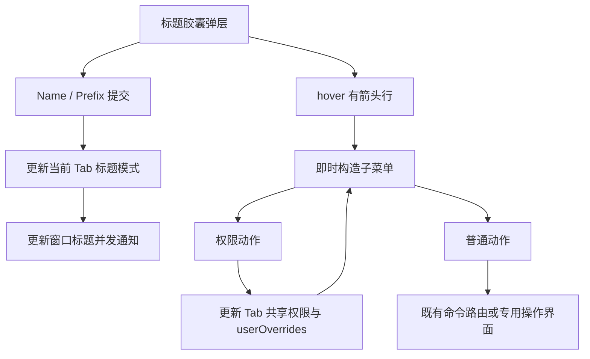

# Otty 1.6.2 Pane 顶部菜单行为证据

> 归档说明：Hopper 原库、关键反编译输出、SHA-256 清单和重开步骤已整理到 [Otty 1.6.2 分析存档](otty-analysis/1.6.2-0fa10277/README.md)。本文中的 `.build/rea/`、任务 worktree 路径与 PID 为历史记录；续查时使用存档中的同名文件，不能当成当前运行状态。

本文记录标题胶囊弹层 `WorkspaceCommandPanel` 的原生行为，用于 Aster 对照实现。范围仅包含此弹层及其直接动作；不把 Otty 内部类型名直接等同于 Aster 类型，也不把未跟完的调用链当作已实现规则。

## 证据与限制

- 原件：`/Applications/Otty.app/Contents/MacOS/Otty`，SHA-256 `0fa1027714a601402cc7df42bf05d5c9fab6434f21e01701e7ce8c4bd8d0942e`。
- arm64 副本：`.build/rea/otty-arm64.macho`，SHA-256 `45a8faffb4ec0f8c03b98e8d4e98091b819faa7d5ae4c43986f030c5cc07810e`。
- 本文地址均为未重定位 arm64 虚拟地址；主要证据是有界 LLVM 反汇编、Mach-O Swift vtable 和 ObjC ivar 元数据，不是原始源码。对应文件为 `.build/rea/pane-header-*.s`、`otty-objc.txt`，散列与提取方式见 `pane-header-provenance.json`。
- 此轮独立 REA driver 打开已保存 Hopper 数据库失败，`pane-header-open.json` 为 readiness timeout；关闭结果为 `cleanup_incomplete`。`ev_cc4eec93c2b00caeec46a2731d295cefad9b0b337dfe626d71aa4475ede54e46` 是失败证据，不能作为成功反编译引用。driver/MCP 已退出；随后主代理通过 CUA 关闭本次 Hopper 文档并退出该进程，未清理其他任务的 REA 进程。
- 本调查没有操作 Otty/Aster UI，没有运行 Git 写操作，也没有修改生产代码或测试。用户报告的 hover 行为与静态路径一致；本文其余规则不等同于真实窗口验收。

## 菜单生命周期与对象归属

`1004b04f4` 展示弹层：保存弱引用的 TabManager/窗口控制器，并依据当前 Tab 构造内容；已有弹层可先关闭。`windowDidResignKey:` 经 `1004b1bb0` 处理，显示后不足 0.5 秒的失焦被忽略，之后失焦关闭。

带箭头行不要求点击：`WSPrivilegesSubmenuRow.mouseEntered` 的 `1004a7e2c` 更新 hover 状态后直接跳到 `1004a65dc` 构造/显示子菜单。一般 `WSSubmenuRow` 的 `1004ad07c` 同样直接调用其展示函数。未观察到 hover 延时定时器。权限行动作包装 `1004a80a8` 执行动作后再构造子菜单，因而开关变化可立即反映在仍显示的菜单里。

作用范围有结构证据：

- `Tab` 元数据 `0x102360240` 的 `+0x18` 是 `PaneState`；后者有 `paneTree` 和 `panes` 字典。`10066423c` 返回 `panes.count > 1`，明确支持一个 Tab 包含多个 Pane。
- `100664548` 根据 paneTree 当前键查 panes，缺失时回退第一项；`100664920` 取其中 terminal case。
- 权限菜单入口 `1004b9a34` 在 `1004b9a84` 调用 TabManager 当前 Tab getter，再调用 Tab 的 `+0x370` getter `10066773c`，读取该 Tab 存储的同一个 `PanePrivileges`。不是按菜单捕获的 terminal 独立创建权限。
- About 的数据对象不同：provider `1004c2ad8` 捕获 `OttySessionWrapper`，Pane ID 来自其 `sessionId`（对象 `+0x18/+0x20`），不是 Tab 的整数 `id`。

## Name、Prefix 与恢复

证据：`pane-header-rename.s`、`pane-header-field-key.s`、`pane-header-title-model.s`。

| 触发 | 处理 | 直接可证的输出/副作用 |
| --- | --- | --- |
| Name 按钮，`1004b5644` | 仅把编辑模式切为 Name；已是自定义模式时显示 customTitle，否则显示自动标题；placeholder 为 `Tab name` | 未提交时不写 Tab |
| Prefix 按钮，`1004b5804` | 切为 Prefix 编辑，显示已有 titlePrefix；placeholder 为 `Prefix...` | 未提交时不写 Tab |
| 文本框 action / Enter，`1004b5d84` | Prefix 模式保留原始 stringValue，设置 titleMode=2、titlePrefix；不清 customTitle | 更新窗口标题，通知并交 TabManager 更新 |
| 同上，Name 模式 | 使用 `CharacterSet.whitespaces` 去首尾空白；非空时 titleMode=1、customTitle=trimmed、titlePrefix="" | 空结果时 titleMode=0，customTitle/titlePrefix 都清空 |
| 恢复，`1004b5980` | 切回 Name 模式、清空文本框，然后立即调用提交 | 立即恢复自动标题，不必再 Enter |
| Escape，`1004bf64c` | 识别 `cancelOperation:` 后关闭 | 不调用提交函数 |

`1004bf64c` 明确拦截 `insertNewline:` 并提交；其他 selector 返回 false。没有恢复到 `textDidChange` 连续提交路径。失焦本身的 native handler 只关闭；AppKit 是否因为特定 field editor 结束编辑而另发 action 尚未真实验证。

标题 getter `10066cb0c`：模式 0 自动标题，模式 1 customTitle，模式 2 为 formattedPrefix + 自动标题。`10066c43c` 根据 prefix 末字符的一个 Character 属性决定是否补一个 ASCII 空格；该属性调用的符号尚未完全核实，不以字段名猜为全部 whitespace 语义。

提交直接更新 `window.title`，空标题使用 `Otty`，并发通知。顶部胶囊自身是否显示 customTitle、cwd 或另一个标题来源，**本轮没有完成 renderer 追踪**；不能仅凭标题 setter 推断胶囊显示结果。

## Notifications & Privileges

实际弹层 builder 是 `1004b9f0c`，不是应用顶层菜单的 `ShellPrivilegesMenuDelegate`。字段由 `PanePrivileges` 元数据 `0x10235ef10` 与 getter/modify vtable 同时确认。

| 顺序/分组 | 原版行 | 字段或动作 |
| --- | --- | --- |
| SOUND | Mute | 强制 `soundOnErrorExit=false`、`soundShellControlled=false` |
| | Beep on Error Exit | 切换 `soundOnErrorExit` |
| | Allow Terminal Bell | 切换 `soundShellControlled` |
| NOTIFICATION | Mute | 强制下面四个 notification 字段为 false |
| | Notify on Command Finish | `notificationOnFinish` |
| | Notify on Error Exit | `notificationOnError` |
| | Notify on Watch Finish | `notificationOnWatchFinish` |
| | Allow App Notifications | `notificationShellControlled` |
| TAB BADGE，普通 terminal | When Command Finishes | **`badgeExitStatus`** |
| | When Command Fails | **`badgeActivity`** |
| TAB BADGE，已识别 agent | While Processing | `badgeAgentProcessing` |
| | When Task Completes | `badgeAgentTaskComplete` |
| | When Awaiting Input | `badgeAgentAwaitingInput` |
| CAFFEINATE，普通 terminal | Keep Awake When Task Running | Tab 的防休眠选择流程，见下节 |
| CAFFEINATE，已识别 agent | Prevent Sleep While Processing | `caffeinateAgentProcessing` |
| MOUSE | Allow Mouse Capture | `mouseShellControlled` |

普通 badge 的映射看起来与字段名称不完全一致，但确实由 builder 的 `+0x178/+0x190` getter 和回调 `+0x188/+0x1a0` modifier 得出，不应自行交换。`1004c1eac` / `1004c1fd8` 切换后额外调用 Tab `+0x6c8`（`10066dabc`）刷新 badge。

agent 判定：Tab `+0x420` 经当前 terminal 的 `+0x558` getter `10065ad78`；它先通过 `+0x540` 把 `programKind` 解析为 Agent enum，未知值 12 返回 nil，已识别类型才返回 `+0x528` 的字符串。不能用“programKind 任意非空”代替。仅 TAB BADGE 与 CAFFEINATE 分支，**agent 的 NOTIFICATION 仍是上面同样四项**。

Mute 是单向操作，不能重复点击恢复以前值：声音回调 `1004c1704`，通知回调 `1004c19c4`。Mute 的勾选状态分别是两项/四项全部关闭的合取（`100656e4c`、`100656e88`）。通知 Mute 不修改 `notifyAgentTaskComplete` / `notifyAgentAwaitingInput`，这两个字段虽然存在于模型，却没有作为这个弹层的独立行出现。

每个动作把被改字段的名字插入 `userOverrides: Set<String>`（`10065748c`），并发通知；不直接写全局 Preferences。对象初始化 `100656f18` 按字段复制全局 Preferences。**全局设置后续如何传播、override 如何跨启动保存，本轮未追完**，不能据初始化推断持久化契约。`mouseShellControlled` 回调 `1004c2118` 未直接调用 PTY 重配；实际消费由其他路径完成，不能宣称该回调立即重设终端 mouse mode。

模型还包括未在此弹层直接显示的 `caffeinateLidClosed`、`titleShellControlled`、`clipboardShellControlled`。这是入口覆盖边界，不是断言这些字段无效。

## 普通 terminal 防休眠

证据：`1004c2208`、`1004bb644`、`1004c164c`，`pane-header-caffeine-actions.s`、`pane-header-caffeine-update.s`。

- 未开启：显示 NSAlert sheet，标题 `Keep macOS Awake`，正文 `Prevent system sleep while tasks run in this tab.`，按钮依次 `For This Task`、`For All Tasks`、`Cancel`。
- response 1000 调 Tab `+0x5d8(false)`；response 1001 调 `+0x5d8(true)`；其余不改变开启状态。该方法 `10066be90` 设 `caffeinateEnabled=true`、`caffeinatePersistent=参数`，然后立即申请防休眠断言并提示。不是只对未来任务设置开关。
- 已开启再次点行：`10066c020` 清当前 Tab 的 enabled/persistent，释放当前 Tab 断言。传入全部 Tabs 只用于选择提示“其他任务仍保持唤醒”或“系统现在可以休眠”，不逐 Tab 关闭。
- `10066b48c` 首先申请 `PreventUserIdleSystemSleep`，成功后申请 `PreventSystemSleep`。第一个失败记录 acquire FAILED 并返回；第二个失败记录 system assertion FAILED，保留第一个已取得的断言。`caffeinateLidClosed` 还会触发额外 helper，未展开到系统级行为。
- 文案区分“本任务退出前”与“直到手动关闭”。已找到 `10066aa10` 遍历当前 Tab 所有 terminal 并聚合执行中状态；**还没有证明具体哪一个命令结束事件清除 For This Task，也没有恢复其与 agent 活动和全局开关的全部优先级**。不能按任意 Tab 结束就清除。

## Split View 与底部入口

`1004b9508` 固定顺序为 Split Right、Split Left、Split Down、Split Up。动作分别为命令枚举 `0x1b`、`0x1c`、`0x1d`、`0x1e`；四个 thunk 位于 `1004c28fc`、`1004c2904`、`1004c290c`、`1004c2914`，共用 `1004c5a24` → `100603d88` 既有命令路由，之后关闭弹层。快捷键展示从当前快捷键管理器查询同一枚举，没有在 builder 写死。

底部同样走既有命令路由：Find=`0x42`（`1004c3fd0`），Find in All Tabs=`0x47`（`1004c3fd8`），Jump=`0x89`（`1004c887c` → `1004c3fc8`），Command Palette=`0x87`（`1004c3fe0`）。本调查没有重新恢复这些全应用功能的内部搜索契约。

## About this Pane

provider `1004c2ad8` → `1004a8108` 生成只读信息行，最后添加 `Copy Pane ID`。信息针对捕获的 `OttySessionWrapper`：

1. `Pane ID: <sessionId>`，不是 Tab id，也不是 `/dev/ttys...`。
2. 可选 `TUI: ...` 或 `Command: ...`，取值优先级由 `1004a8824` 控制。
3. `Opened: ...`，取 session openedAt，`1004a8c10` 使用 NSDateFormatter medium date、short time、relative date formatting；另可附一个时间 helper 的文本，精确相对时间格式未恢复。
4. `Device: ...`，`1004a8d80`：anywhereHost 的显示名与 OS；否则 sshInfo 的用户名/主机并加 ` · SSH`；本地用系统 ComputerName（不可得回退 `This Mac`）加 ` · macOS`。OS 字符串 macos/windows/linux/ios 分别显示 macOS/Windows/Linux/iOS，其他保留原值。**不是 tty 设备路径**。
5. 非空时显示 `Opened from: <openedByDevice>`。

命令摘要优先取 terminal `+0x5c0` 返回值（有值时强制 TUI）；然后取 runningCommand（`+0x780`）；部分远端/TUI 情况回退 title；再回退原生 foreground pid path 的 basename；最终 shell + ` (idle)`。runningCommand/title 路径把换行替换成 ` ⏎ `，String.count >=61 时取前 59 个 Swift Character 加 `…`。该优先来源没有完全命名，不能把所有情况简化为 currentCommand。

Copy Pane ID 回调 `1004c2e14` 关闭弹层，把捕获的 sessionId 与窗口交共享复制/反馈 helper `1005ffef8`。本轮没有继续恢复该 helper 的反馈文案或复制失败处理。

## Git 子菜单

builder `1004b6a00` 至 `1004b7b60`；动作证据见 `pane-header-git-*.s`。

列表有可选仓库摘要（worktree 附标记与状态文本），随后 Commit...、Create Branch...、分隔、Push、Pull、Fetch、分隔、Merge...、Rebase...。后部可能有 `Switch to` 标题、`Open in <app>` 行和 remote URL 行。**不能把这组操作等价成在 shell 中预填命令。**

| 动作 | 已恢复流程 |
| --- | --- |
| Commit... | `1004c616c` 先关闭弹层；`100587dc8` 派发后台检查，`100588034` 调仓库状态 helpers，回主线程 `10058bd3c` → `10058cefc` 打开专用 CommitPanel。表单字段、staging 选择、提交选项和失败界面未在此轮恢复。 |
| Create Branch... | `1004c6244` 关闭弹层，显示输入框 `Create Branch` / `Enter the name for the new branch:` / placeholder `branch-name` / 按钮 `Create`。回调 `1004c65a0` → `100582e2c` 使用 argv `[git, -C, cwd, checkout, -b, input]`，返回 exitStatus==0。输入框的 trim/空值校验和 UI 如何呈现失败尚未追完。 |
| Push | `1005882b8` 后台取得分支，`10058b964` 显示确认 sheet：`Push to Remote`，`Push "<branch>" to the remote repository?`，Push/Cancel。argv `[git,-C,cwd,push]`。 |
| Pull | `100588770` 确认 sheet：`Pull from Remote`，`Pull latest changes from the remote repository?`，Pull/Cancel。argv `[git,-C,cwd,pull]`。 |
| Push/Pull 执行边界 | 共用 `100589294`，仅 response 1000 执行，交 `1005854b0` 启动子进程并显示进度/可取消 UI。没有 keyWindow 时退出，不直接运行。 |
| Fetch | `100588a4c` 无前置确认，argv `[git,-C,cwd,fetch]`，进度文本 `Fetching...`，同进程 runner。 |
| Merge... / Rebase... | `100588c90` / `100588f94` 后台取得分支后展示选择界面：Merge Branch / Rebase onto Branch。回调 `10058ab70` / `10058abc4` 经 `1005852f8` / `10058530c` 构造 `[git,-C,cwd,merge/rebase,selectedBranch]`；捕获 stdout/stderr/status，status0 表示成功。没有额外 `--` 参数。分支筛选与排序、冲突处理细节未恢复。 |
| Open in app | `1004c64bc` → `10057edcc`：应用配置可为 `otty-command:` 命令或 bundleID；后者查安装路径，通过 NSWorkspace 打开 cwd。找不到应用时不执行该路径。 |
| remote 链接 | `1004c6524` → `1004c6528`，将已构造 URL 交 `NSWorkspace.openURL:`。URL 从 Git remote 归一化的全部规则未恢复。 |

`Switch to` 的边界必须保留：`1004b7240–1004b72e4` 在 gitInfo 的 `+0x38` 数组数量 >=2 时追加分隔和这个标题；其后可见循环 `1004b7500–1004b7624` 明确生成的是 **Open in app** 行。当前有界 builder 中尚未定位到分支行添加或 checkout callback。不能依据标题自行宣称已恢复了切换分支行为；需要原版多分支 fixture 验证是否存在空标题或额外路径。

## Working Directory 与 Open in 的边界

`1004b60f8` 建 Working Directory 标题和路径展示。Finder helper `10057b228` 调用 `NSWorkspace.selectFile(nil, inFileViewerRootedAtPath: cwd)`；Terminal helper `10057b298` 查 `com.apple.Terminal`，存在才用 file URL 打开 cwd。通用 Open-in helper 支持 bundleID 和 `otty-command:`，因此“固定若干已安装应用”只是实现选择，尚不能宣称与原版完整的应用发现/配置规则相同。

Copy Path 的入口与文本已定位，但本轮未把 captured path 的本地/SSH/anywhere 分支、剪贴板具体数据类型和成功反馈跟到终点。路径不存在、远程路径不可在本机打开以及应用启动失败的用户可见处理仍属未验证范围。

## 可直接派生的测试

- Name 空白提交回自动模式；非空 trim；Prefix 原始空白保留；Reset 立即清两字段；Escape 不提交。
- hover 二级菜单无需 click；权限切换后 submenu 内容刷新。
- 声音 Mute 只清两字段；通知 Mute 只清四字段；反复 Mute 不恢复；agent NOTIFICATION 沿用普通四行。
- badge 普通两行与已恢复字段对应；agent 判断排除未知 programKind。
- 同一 Tab 多 Pane 的权限操作共享对象；About Pane ID 随捕获 terminal 改变。
- Keep Awake Cancel 不改变开启状态；For This Task 与 For All Tasks 只差 persistent；关闭只影响当前 Tab。
- Split 顺序和四个命令路由；底部 Find/All Tabs/Jump/Palette 路由与当前快捷键查询。
- Push/Pull 取消不启动进程；Fetch 可直接启动；Create Branch、Merge、Rebase argv 保持每个输入为独立参数。
- About 本地 Device 是 ComputerName + macOS，不是 tty；长 runningCommand 按 Character 截断并替换换行。

上述是恢复规则测试建议；真实窗口行为、系统通知交付、IOKit 实际阻止睡眠、Git 网络失败/认证/冲突均需主流程另行验收。本文没有为这些未验证事项提供完成声明。
