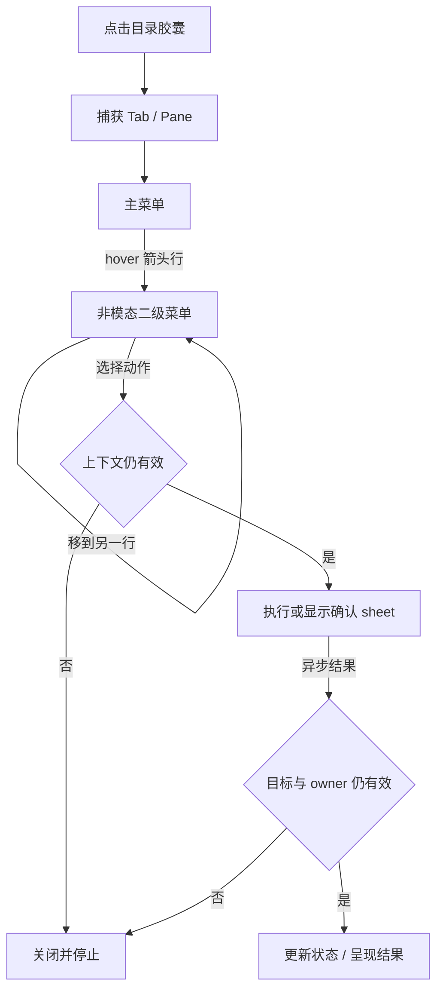

# Pane 顶部菜单

## 背景与领域对象

点击工作区顶部目录胶囊，围绕打开时的标签与 Pane 执行命名、目录操作、Git、通知权限、分屏、信息查看和导航。结构目标来自 Otty 1.6.2；原版二进制证据、地址及未恢复项见 [恢复记录](otty-pane-header-findings.md)。

`TerminalTabItem` 保存命名状态和共享 `PanePrivilegesState`；一个标签的所有终端分屏绑定同一权限对象，其他标签隔离。`WorkspacePaneRuntime` 保存本次打开时间。`TabTitleEditorState` 保存生效模式及 Name/Prefix 两个字段，作为可选字段写入工作区快照，兼容旧快照。普通权限覆盖与防休眠租约仅保留在本次运行，不改全局偏好。

## 核心规则

- Name 提交 trim 首尾 whitespace；空名称恢复自动模式，同时清 Prefix。Prefix 保留末尾空格与之前的 Name。从 Prefix 切回 Name 时，生效模式仍为固定名称则填该名称，否则填未加前缀的程序/Agent 自动标题（可为空）；重选同一分段不清草稿，切换不提交。Reset 立即清两个值并切回 Name。保留 Aster 标题的控制字符过滤和 512-byte 限制。
- 主菜单鼠标进入带箭头的行立即展开，不设计时或第二次点击。进入另一行替换二级菜单；进入普通动作行收起。子窗口不取得键盘焦点，根窗口持续接收 hover。键盘方向键选项，Right 只展开子级，Return/Space 执行动作，长菜单自动滚动到选中行。
- 根菜单使用无箭头圆角 `WorkspaceTitlePanel`，位于目录胶囊下方并夹在可用屏幕内。点击根弹层及任一级子菜单窗口以外的位置，会同时收起整条菜单；左键、右键和其他鼠标键均适用，原点击继续交给目标。切走应用或关闭所属窗口也会关闭。`PaneMenuDismissalMonitor` 随弹层显示/关闭安装和释放监听；入口按钮自行处理开关，避免提前关闭后又被 action 重新打开。
- 展开时捕获标签和 Pane 标识；切换活动 Pane/标签关闭菜单。目录、分屏和查找入口验证该上下文，不能对后来选中的 Pane 误操作。
- Open in 按 VS Code、Cursor、Xcode、Zed、Finder、Terminal 顺序显示已安装应用和真实图标。无效或远端目录不打开本机路径；点击时复查目录及安装态，错误交给宿主显示。
- Git 异步读取仓库，加载状态就地显示；hover 离开后迟到结果不能替换另一个菜单。Commit 只提交已经暂存的文件；Create Branch 使用 `checkout -b`。Push/Pull 确认后执行，Fetch 直接执行；Merge/Rebase 先选分支。所有输入通过 argv，进程有输出上限、超时与取消，环境排除会重定向仓库的 `GIT_*` 变量。异步返回、确认结束和执行前重新验证目标，owner 消失会结束 sheet。
- 声音静音关闭错误提示音和 Bell；通知静音关闭命令完成、错误退出、监视完成和应用通知。重复静音不重新开启。独立 Agent 通知不被该静音动作清除。
- 徽标按普通命令/Agent 展示对应选项。鼠标捕获用 Ghostty per-surface `mouse-reporting` 设置；关闭后键盘、本地选区和滚屏仍可用，全局 reload 后重放各 surface 覆盖。
- 普通防休眠通过发起窗口的 sheet 选择本次/所有任务/取消。启用立即持有防休眠请求；本次请求在选定会话结束或关闭后释放，所有任务直到显式关闭。Agent 防休眠只在 processing 生效。
- 分屏顺序 Right、Left、Down、Up。About 显示真实 Pane ID、命令/Agent、打开时间和设备，可复制 Aster Pane ID。导航动作关闭弹层后复用正式功能入口。

## 实现边界与失败行为

UI 编排在 `WorkspaceTitlePopover`、`PaneHeaderActions`；`WorkspaceTitlePanel` 负责无箭头主窗口的位置、材质和所属窗口生命周期，`PaneMenuView` 负责鼠标、键盘和级联子窗口，不执行 Git。目录应用启动在 `PaneDirectoryApplications`；Git 查询/变更与 AppKit 流程分离为 `PaneGitService`/`PaneGitMenu`。权限规则在 AsterCore，App 层分别接 Session、Dock 和 Ghostty。

已关闭对象不执行动作；仓库读取失败在菜单显示原因；Git 操作失败呈现 stderr 与退出码，取消不报成功。不自动解决 Git 冲突、执行认证或重试写操作。未安装应用不显示，打开失败明确反馈。权限拒绝及系统通知交付继续遵守已有通知服务策略。

## 与原版仍可见的差异及未验证边界

| 范围 | 当前 Aster 与原版的边界 |
| --- | --- |
| 主菜单外观与失焦 | 使用无箭头圆角 NSPanel；字号、内边距、阴影、材质以及不同语言长度未声称逐像素相等。原版显示后 0.5 秒内忽略失焦；按用户要求，Aster 外部点击或切走应用时立即关闭。 |
| 命名 | 保留 Aster 的标题安全过滤/长度限制；原版极长文本和控制字符的完整处理未恢复。原版名称提交后顶部胶囊 renderer 未验证，Aster 胶囊继续按目录/Agent 标题显示。自动标题来源沿用 Aster 的 OSC/Agent 通道，未完整复刻 Otty 的全部回退来源。Prefix 在 Aster 中原样拼接；原版末字符决定是否补一个空格的属性判断未完全恢复。 |
| Open in | 覆盖截图中的六类已安装应用；未实现原版完整自定义 `otty-command:` 及应用发现规则。远端路径本机打开被禁用，原版错误反馈未完整恢复。 |
| Git Commit | 当前为已暂存改动摘要和提交信息；未复刻 Otty 专用 CommitPanel 的所有文件选择、暂存及提交界面。 |
| Git 其余 | 本地分支切换已实现；原版仅恢复到 Switch to 标题，具体分支行需原版运行验证。仓库摘要、remote 标签、图形 Git 客户端与 `otty-command:` 外部入口未逐项一致。 |
| 权限生命周期 | Aster 未覆写字段继续跟随全局；原版后续全局传播、覆盖跨重启持久化尚未恢复。当前覆盖在关闭标签/退出应用后清除。 |
| 防休眠 | 本次任务按所选会话完成/关闭释放；原版精确结束 handler 未恢复。Aster 使用既有 IOKit 协调器，不实现原版合盖 helper 及全部系统断言反馈。 |
| About | Aster ID 为自身 Pane UUID；没有原版 openedByDevice 来源字段。TUI 识别及空闲/前台命令回退、相对时间格式、复制反馈不完全相同。 |
| 快捷键与导航 | 菜单使用 Aster 的现有命令及快捷键；全应用查找、Jump、命令面板内部契约不在本次复刻范围。部分底部快捷键文案仍使用默认显示，未完整复刻 Otty 查询所有自定义绑定的行为。 |
| 系统/远端 | macOS 通知实际交付、合盖睡眠、真实远端 SSH、Git 网络认证/冲突未作对照验收。 |

## 验证

使用 `./scripts/test.sh --filter 'paneHeader|paneTitleEditor|paneDirectoryApplications|panePrivileges|paneGit|workspaceTitlePopoverExposesWorkingActions'`。测试覆盖恢复规则、hover 无点击、键盘滚动、失效目标、分屏共享、真实 Ghostty 字节和临时本地 Git 仓库；不访问真实 Git remote。真实窗口及当前构建证据保存在 `.design-loop/pane-header/ui/`，完成记录见该目录的 `final.md`。未运行全量套件。
