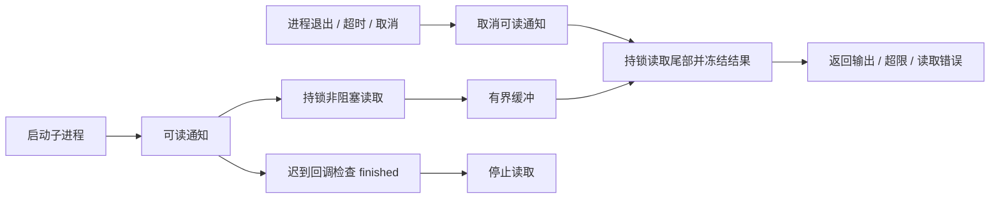

# 有界子进程输出与退出收尾

## 背景

工作区恢复会异步执行 Git 项目目录探测。0.6.18 的三份真实崩溃转储指向
`MemoryProcessRunner` 的 `FileHandle.availableData`：退出收尾将管道设为非阻塞，
已经开始的可读回调仍继续读取，EAGAIN 被 Foundation 转成未捕获的
`NSFileHandleOperationException`，整个应用终止。

清空 `readabilityHandler` 只取消通知，不能撤回已经执行中的回调。因此不能把清空
handler 当成读取完成，也不能让 Foundation 读取与 POSIX 尾部读取同时操作同一读端。

## 职责与核心规则

`PipeOutputCapture` 是 Aster 应用层内部的管道基础设施，不依赖 Core、UI 或第三方 SDK。
Git/进程检查、SSH 配置解析、项目目录探测和记忆提炼四个执行器共用它，避免分别维护
同一套易出错的管道生命周期；命令参数、环境、等待、超时、取消和信号升级仍由执行器负责。

- 独占读端：调用方不得再从传入的 FileHandle 读取或关闭它。
- 初始化时设置 O_NONBLOCK。FileHandle 只提供可读通知，实际读取使用 POSIX read。
- 回调、数据缓冲与退出收尾使用同一把锁；迟到回调看到 finished 后直接返回。
- EAGAIN/EWOULDBLOCK 表示暂时无数据，EINTR 重试；其他读取错误返回 errno，由调用方按失败降级。
- 最多保留 maximumBytes 字节，额外读取一个字节判断真正超限；通知执行器停止进程。
- finish 取消通知，等待正在读取的回调释放锁，再收集已有尾部输出并冻结结果；重复调用幂等。
- 不等待 EOF：孙进程可能仍握住写端，只有本次命令已经到达的数据属于返回结果。
- 不记录输出正文、命令、环境或用户目录。读取失败不能使应用异常退出。



## 验证

`PipeOutputCaptureTests` 使用真实管道覆盖空读 EAGAIN、保留的迟到回调、回调与收尾并发、
完整输出顺序、恰好达到上限和尾部超限；实际执行器覆盖快速退出、孙进程保留写端、
超时、取消与输出限制。例：

```sh
./scripts/test.sh --filter 'pipeOutputCapture|processRunner|processOutputLimits' --no-parallel
```

启动故障的修复不调整现有三次崩溃后跳过快照的恢复策略，也不清空用户的工作区数据。
