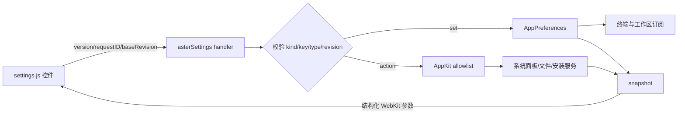

# 网页设置架构

当前设置界面有十二类 WebKit 分类（含编辑器、主机、工具），由 AppKit 根容器和标题栏拖动条承载；原生设置控件保留为开发诊断回退。
## 背景

Aster 设置页以 Otty 1.3.1 应用包内的 `settings-ui.html` 为功能与视觉基准，并以应用自有 HTML、CSS 和 JavaScript 实现。外观分类逐段对应原页的布局选择、标签页、窗口、主题详情、文本、四级字体来源、光标和 Dock 图标；主题详情同时覆盖语义 token 与 ANSI 16 色。

没有把 Otty 的编译产物原样复制进 App Bundle：该文件直接调用私有的 `window.webkit.messageHandlers.otty`，原样使用会让 Aster 依赖 Otty 的消息协议和安装路径。Aster 保留相同页面结构与交互契约，改由受控的 `asterSettings` bridge 接入自身强类型配置，也不加载远程页面。AppKit 继续拥有窗口、系统面板、文件选择器和所有本机副作用，网页只负责展示与提交结构化意图。

## 领域边界

- `Resources/settings-ui/index.html`：静态入口与 CSP，只允许同目录脚本、样式和图片，禁止网络连接、对象、表单和外部 base URL。
- `Resources/settings-ui/settings.js`：十二类字段清单、搜索、Otty 外观页专用渲染器、主题/Agent/Recipe/快捷键列表和消息协议。
  Recipe 列表里的命令片段行（快照 `recipes[].snippet == true`）多出「编辑…」「删除…」，分别发 `editSnippet` / `deleteSnippet {id}`，由原生表单与确认框处理；见 [Workflows 与 Agent](workflows-and-agents.md)「命令片段」。
- `Resources/settings-ui/settings.css`：Otty 风格的 200px 侧栏、单列卡片、外观预览、明暗外观、键盘焦点和响应式布局。
- `Resources/settings-ui/nav-icons.js` / `nav-icons.css`：侧栏分区图标（24 网格，淡色填充 + 描边）与点击动画，对齐 Otty。`renderNav` 用 `AsterNavIcons.svg(id)` 填图标；点击时 `setSection` 会重建侧栏，所以动画要播在重建后的新按钮上（`AsterNavIcons.play`）。系统开启「减弱动态效果」时不播放。新增分区要同时补图标、动画名和测试 `SettingsNavIconsTests` 里的清单。
- 滚动面包屑：`index.html` 的 `.content-column` 里 `#content-topbar` 悬浮在滚动区之上。内容滚过 24px 时 `#app` 加 `content-scrolled`，面包屑（Aster 标志 / 设置 / 当前分区）淡入，页内大标题淡出，过渡 200ms；切换分区或搜索时回到顶部并复位。
- `SettingsViewController`：创建非持久化 `WKWebView`，只允许 `settings-ui` 目录内的 file URL 导航；接收消息、校验字段和执行 allowlist action。
- `AppPreferences`：强类型 `AsterConfiguration` 是运行时真值；尚未进入运行时模型的跨平台字段由 `SettingsCompatibilityValue` 按 Bool、Number 或 String 原类型持久化。
- `SoftwareUpdateService`：全仓库唯一 `import Sparkle` 的文件。设置页与菜单只见 `SoftwareUpdateControlling` 协议；更新检查由原生侧发起，网页仍然不能联网。

Windows 的 `windowsTextRendering` 字段会完整显示和往返，但 capability 明确为 false，macOS 上不可编辑。产品外链和已废弃 Auto Approve 不进入清单。自动更新自 0.5.0 起进入「通用 → 更新」，但四个字段的真值都不在本页的两层存储里：两个自动开关归 Sparkle 自己的 `UserDefaults`，通道归 `AppPreferences` 的独立键，详见 [`software-update.md`](software-update.md)。开发构建与未配置更新源的构建下 `capabilities.softwareUpdate` 为 false，该组整体置灰。

## 消息流程



桥协议版本为 1。`set` 一次最多 32 项，字段名和文本长度有上限；未知字段、错误 JSON 类型和过期 revision 均拒绝。Swift 使用 `callAsyncJavaScript(arguments:)` 传入结构化对象，不把用户文本拼进脚本源码。动作只能进入 Swift switch 的显式 allowlist，网页不能直接访问文件或执行命令。`checkForUpdates` 是本页第二个会发起网络请求的动作（第一个是 `updateAutocomplete`），且结果不同步返回——Sparkle 的更新会话包含用户交互，可能持续数分钟，状态经 `.softwareUpdateStatusDidChange` 通知回流刷新快照。

## 配置与运行时

设置变更通过 `AppPreferences.objectWillChange` 实时通知现有工作区。字体、主题 token、ANSI 16 色、光标、选择、剪贴板、通知声音、链接安全、Agent、Panel 宽度、Recipe 重放、终端类型和 East Asian Ambiguous 宽度等沿用强类型配置；Shell 路径、Scrollback 与背景透明度也会作用到新建或现有终端。普通、粗体、斜体和粗斜体各自拥有 fallback 链，未配置的样式继承普通 fallback。主题颜色写入按主题 ID 隔离的 override，内置主题在首次修改字体或 ANSI 色时先复制为用户主题；能映射到文件键的 token 同步到 `.astertheme` 的 managed 段。快捷键录制保存为可读符号串，由 `ShortcutOverrideApplier` 修改现有 AppKit 菜单的 `keyEquivalent`，不复制 selector 或绕开 responder chain。

设置窗口打开期间，只合并由配置广播触发的工作区整树刷新；现存终端偏好仍就地应用，
而 Tab、Pane、焦点和其它工作区模型变化继续经过普通 `scheduleRefresh()` 立即显示。设置页的
`WKWebView` 延伸到 `.fullSizeContentView` 的透明标题栏区域，上层原生 `SettingsTitlebarDragStrip` 将该区域的鼠标事件交回窗口，保留拖动能力。

设置页按 `appearance.interfaceTextScale` 设置 `WKWebView.pageZoom` 整页缩放，写入后立即生效，不等重启；网页样式里的 px 字号因此保持不变。快照字段 `appearance.interfaceStrongTextActive` 为真时，网页给根元素加 `strong-text` 类切换加深配色。详见 [界面文字可读性](interface-text-legibility.md)。

软件更新的四个字段不写入 `settings.json`，导入导出也不携带它们。

可编辑配置文件位于 `~/Library/Application Support/Aster/settings.json`，schema 版本为 3，同时包含强类型配置和兼容字段。导入仍接受旧版单块 `AsterConfiguration` JSON；新格式只接收 allowlist 中的兼容字段，本机链接与剪贴板授权继续按原有安全规则剥离。

## 资源与失败语义

`scripts/build-app.sh` 必须把 `Resources/settings-ui` 复制到签名 App Bundle。资源缺失时设置窗口不回退到远程 URL，而是报告需要重新构建。异步动作把成功或失败消息回传页面；配置文件解码失败时保留当前配置不变。

外观页 Dock 图标预览的品牌 logo 以内联 SVG 写在 `settings.js` 的 `makeDockGroup`：`WKWebView` 的读权限只覆盖 `settings-ui` 子树，网页引用不到上层 `Resources/AsterIcon.svg`。图稿真值仍是 `Resources/AsterIcon.svg`，改动 logo 时两处需逐路径同步。

## 验证

`SettingsResponsivenessTests` 与 `AppKitMigrationTests` 覆盖窗口几何、原生标题栏拖动边界、设置打开期间 Tab/Pane 与标签栏布局实时刷新、单一非持久化 WebView、CSP/十二类资源、Otty 外观页结构与范围控件真值、主题详情快照、Windows capability、强类型与复合字段写入、动态 Agent 字段、菜单快捷键、兼容字段持久化和活动工作区 Panel 宽度。软件更新一组另有专门回归：`settingsBridgeRoutesUpdateSettingsToUpdaterAndPreferences`（真值归属）、`settingsSnapshotExposesUpdateStatusAndCapability`（状态点与取反派生键）、`settingsUpdateActionTriggersCheck`（action allowlist 与重入）、`settingsUpdateSectionMatchesBridge`（网页清单与 Swift 桥、CSS 状态色一致）。「工具」分类见 `SettingsToolsBridgeTests`：快照形状与排序、动作参数校验、合并推送、快捷键兼容键与双向冲突、网页卡片渲染，以及网页动作名与 Swift 白名单一一对应。发布前还需运行：

```bash
node --check Resources/settings-ui/settings.js
swift build
./scripts/test.sh --no-parallel
scripts/build-app.sh
```

最后打开打包后的 Aster.app，逐类检查搜索、明暗外观、键盘导航、主题、Agent 安装状态、Recipe 列表、快捷键录制和系统面板动作。

## 「视图」分类

- 模型在 `AsterCore/ViewConfiguration.swift`：`ViewConfiguration` 是 `AsterConfiguration.view` 的可选顶层块（缺键的旧文件必须还能解码，否则整份配置会回退默认），字段都带 `resolved*` 读取口，`normalized()` 在导入 / 网页写入边界裁掉控制字符与超量条目。
- 标签规则由 `TabTitleRuleResolver` 纯函数解析（glob 条件 AND、三个字段各取首个命中、`${a|b|'lit'}` 回落模板）；`Sources/Aster/TabTitleRuleService.swift` 负责把运行态标签投影成 `TabTitleContext`（git 分支只读 `.git/HEAD` 并按目录缓存 2s）。侧栏 / 横向标签行经 `TabRowButton(tabIcon:badgePlacement:)` 渲染图标；`WorkspaceView` 用 `renderedViewConfiguration` 判断设置窗口打开期间是否需要重建标签行。
- 标签标题颜色：调色板与分配规则在 `AsterCore/TabTitleColor.swift`（`TabTitleColorPalette`）。开关 `view.randomTabTitleColors` 默认开启，只控制**自动色**是否渲染；用户在标签右键菜单里手动设的颜色写在 `WorkspaceTabSnapshot.titleColor`，与开关无关，永远显示。自动色存的是调色板索引（`autoTitleColorIndex`）而不是颜色值，因此调色板改动后老标签跟随新色板——**索引只能追加，不能重排**。分配发生在 `AppModel.insertTab`（插入前算，占用集合正好是「其它标签」）与恢复路径的一次性补齐；`allocateIndex` 先用没被占用的颜色，用完后从占用次数最少的一组里随机取，「不撞色」只在单个窗口内保证（每个工作区窗口有自己的 `AppModel`）。渲染走 `TabRowButton(titleColorProvider:)`，改色经 `TerminalTabItem.titleColorChanged` 局部刷新行内文字，不重建侧栏与终端。
- 图标集在 `Resources/settings-ui/tab-icons/*.svg`（Lucide，ISC；另含若干品牌标志）。网页端由原生随快照下发 SVG 文本（`view.iconSVGs`）内联渲染——`file://` 页面下 CSS `mask-image` 会被 CSP 拦下；原生端用 `NSImage(contentsOf:)` 作模板图着色。图标名只接受 `[a-z0-9-]`。
- 网页窗格：`WebPaneDataStorePolicy` 决定 `WKWebsiteDataStore`（持久 / 进程内共享的非持久），`clearAllBrowsingData()` 清两者；动作 `clearWebPaneData` 经 toast 回报真实结果。
- 详情面板：`DetailsPanelViewController` 按 `resolvedDetailsPanelEntries` 生成 chip，`synchronizeSectionsIfNeeded()` 在偏好变化后重建；自定义视图由 `DetailsPanelCustomViewController` 承载——TUI 走 `GhosttySurfaceView.command`（libghostty surface `command` 字段，`wait_after_command`），网页走独立 WKWebView（移动版 = 自定义 UA）。选中态用 `inspectorSection` + `inspectorCustomSection` 两个键持久化。
- 网页键：`view.rulesArrangement`、`view.badgePlacement`、`view.randomTabTitleColors`、`view.webPanePersistData`、`view.tabRules`（对象数组整体回写）、`view.detailsPanelSections`、`view.detailsPanelCustomViews`、`view.detailsPanelOrder`（`builtin:<id>` / `custom:<uuid>`，快照含隐藏项）。角标三个开关沿用 `shell.badge*` 键，只是从 Shell 分类移到了视图分类。

## 「工具」分类

「工具」排在「Recipes」之后，管理工具箱插件与工具面板的全局快捷键。插件格式、信任状态与运行方式见 [工具箱与插件](tools-and-plugins.md)。

- 前端：页顶「工具面板」一组是 `settings.js` 的普通行——「打开工具面板」按钮（动作 `tools.openLauncher`）与「工具面板快捷键」下拉（兼容键 `tools.launcherShortcut`，取值 `none` / `optionSpace` / `controlOptionSpace`，默认 `none`，走普通 `set` 管线）。下面的插件管理由 `special:"tools"` 渲染器 `Resources/settings-ui/tools.js`（`window.AsterTools.render(ctx)`，`ctx` 为 `{ t, data, mutate }`，`data` 即快照里的 `tools`）画出：「已安装」插件卡片（名称、版本、来源徽章、说明、功能数、启用开关、待确认原因与「确认权限…」、按风险着色的权限、网络域名、在 Finder 中显示 / 卸载 / 移除开发目录）、「问题」（无问题时整组不显示）与「开发」（插件目录、从文件夹安装、开发目录列表、重新扫描）。除内置外没有插件时，「已安装」顶部给一句引导。新文案要补进 `i18n.js` 五种语言。
- 搜索：`tools.js` 的 `searchEntries(t)` 给出本页条目，`settings.js` 把它们放进 `searchOnly` 组——只进全局搜索、不按普通行渲染。条目的 key 与行上的 `data-setting-key` 一致，点开搜索结果能定位高亮。`settings.js` 初始化时就读这份条目，所以 `index.html` 里 `tools.js` 必须排在 `settings.js` 之前。
- 快捷键互斥：下拉行可以声明 `conflictKey`（对方的键）、`conflictNote` 与 `conflictWarning`。对方已占用的组合禁用并注明（`none` 不算占用）；当前值已经撞车（导入的旧配置）时保持可选，并在行内警告。「通用 → Quick Terminal → 全局快捷键」与工具面板快捷键互相声明。原生侧 `applyWebSetting` 写入兼容键前调用 `SettingsToolsBridge.validateShortcutChoice`，两个方向都抛 `SettingsShortcutConflict`，网页显示「设置值无效」toast 并恢复真值。导入配置不做这项检查，两个键相同时由启动器注册失败时提示。
- 快照键 `tools`：`launcherShortcut`、`quickTerminalShortcut`、`pluginsDirectory`、`plugins[]`、`issues[]`、`developmentFolders[]`，形状见 [工具箱与插件](tools-and-plugins.md)「设置页「工具」」。`plugins` 先按来源（用户安装 → 开发中 → 内置）再按名称排序；`permissions` 按风险从高到低、同级保持清单里的声明顺序；`statusReason` 只在 `needsApproval` 时有值，其余为 `null`。
- Swift 侧：协作者 `SettingsToolsBridge`（注入 `ToolManaging`，默认 `ToolCenter.shared`），`SettingsView` 只负责接线，没有放宽任何 private 成员。订阅 `changes` 后合并成下一轮主队列的一次推送；动作自己推快照时取消已排队的那次，同一次变化只推一份快照，避免网页下一次提交因 revision 又涨而被判过期。
- 动作白名单（`tools.` 前缀）：`setEnabled {id, enabled}`、`approve {id}`、`uninstall {id}`、`reveal {id}`、`openPluginsFolder`、`reload`、`installFromFolder`、`addDevelopmentFolder`、`removeDevelopmentFolder {path}`、`openLauncher`。`id` 必须在当前插件列表里，`enabled` 只认 JSON 布尔值，`path` 必须是已登记开发目录的原值；不满足时用 toast 说明（插件不存在等沿用 `ToolCenterError` 的文案），并以失败回执。`openPluginsFolder` 在目录不存在时先创建；`reveal` 遇到没有目录的内置原生工具只提示。
- 原生交互：卸载只对用户安装的插件，先弹原生确认「卸载插件「X」？」（插件目录会移到废纸篓，插件数据会删除）；内置插件不可卸载；开发中的插件只能在「开发」里移除登记，源码目录不动。授权确认、卸载确认与文件夹选择都以 sheet 挂在设置窗口上（不用 `runModal`，见 [工程陷阱](engineering-pitfalls.md)），同一时间只允许一个。用户取消、拒绝授权（`approve` 返回 false 或抛 `.declined`）不算错误，静默结束。异步动作完成时设置窗口已经关闭，就不再推快照、提示或回执。
- 网页侧不依赖回执：确认框可能开很久，会超过 5 秒的回执超时，页面状态一律以下一次快照为准（`send` 吞掉 reject）。
- 原生回退页（无法创建 WebKit 视图时）只显示一行说明与「打开工具面板」按钮。

## 「主机」分类

「主机」排在「智能体」之后，**只承载「Agent 访问」**（agent 远程执行的总开关、授权、agent 终端、MCP 安装与活动记录），没有子标签控件。主机列表、编辑器、密钥保险库和已知主机都不在设置里，只在侧栏「主机」页（见 [原生 SSH](native-ssh.md) 的「侧栏主机页」）。

- 前端：分类入口是 `special:"hosts"` 渲染器 `Resources/settings-ui/hosts.js`（`window.AsterHosts.render(ctx)`），它只画页顶说明与按钮，再把 Agent 访问交给 `Resources/settings-ui/agent-access.js`，入口 `window.AsterAgentAccess.render(container, hostsSnapshot, send, ui)`。`container` 是页面容器，每次快照都会传入新节点，不要缓存；`hostsSnapshot` 即快照里的 `hosts` 对象；`ui` 为 `{ t, makeDialog, showToast, element, button }`（翻译函数、模态框骨架、toast 与节点工具）。新文案要补进 `i18n.js` 五种语言。
- 页顶说明与入口：一行说明「主机、密钥与已知主机已移到侧栏「主机」页。」和按钮「打开主机页」。按钮发动作 `hosts.openHostsPage`，由原生在最前面的工作区窗口里打开侧栏「主机」页。
- 快照键 `hosts`：只有 `agentAccess`。
- Swift 侧：这一类的 bridge 只有协作者 `SettingsAgentAccessBridge`，`SettingsView` 只负责接线，没有放宽任何 private 成员。
- 动作白名单（`hosts.` 前缀）：`setAgentAccessEnabled`、`revokeAgentGrant`、`revokeAllAgentGrants`、`agentAuditPage`、`installAgentMCP`、`openHostsPage`。`send(action, payload = {})` 等价于 `mutate("action", { action, payload })`，返回 Promise：原生回执成功时 resolve；失败、桥不可用或 5 秒内没有回执时 reject。失败原因原生侧已经用 toast 说明，不关心结果的调用方要写 `.catch(() => {})`，并以下一次快照为准。
- 消息：`agentAccessAuditPage`（`hosts.agentAuditPage {before?, limit≤50}` 的分页结果，异步送回）。
- 「高级 → SSH → SSH 引擎」（`shell.sshEngine`）在「高级」分类，走普通 set 管线。**重启后生效**。

语义与审计字段见 [Agent 远程执行](agent-host-access.md)。

### 已移除的网页入口

主机列表与表单、密钥保险库、已知主机的网页实现已整体删除，不再有对应的快照键、动作或消息：

- 模块：`hosts-form.js`、`ssh-keys.js`、`known-hosts.js`；`hosts.js` 只剩上面的最小分类入口。
- Swift bridge：`SettingsHostsBridge`（含 `+Actions`）、`SettingsKnownHostsBridge`、`SettingsSSHKeysBridge`（含 `+Actions`、`+Original`）。
- 消息：`hostsEdit`（原生「编辑主机…」深链）、`hostsImportReport`。
- 动作：`hosts.save`、`duplicate`、`delete`、`forgetPassword`、`addMachine`、`import`、`editSSHConfig`，`hosts.keys.*`，`hosts.knownHosts.*`。

原来从设置打开主机编辑器的入口改为打开侧栏「主机」页：终端标签右键菜单的「编辑主机…」和 Open Quickly 主机行的「编辑主机…」经 `AppModel.showHostEditor(hostID:)` 打开主机页并带出该主机的原生编辑面板；「新建工作区」面板里的「添加主机…」打开主机页并带出新建主机面板。详见 [原生 SSH](native-ssh.md)。
